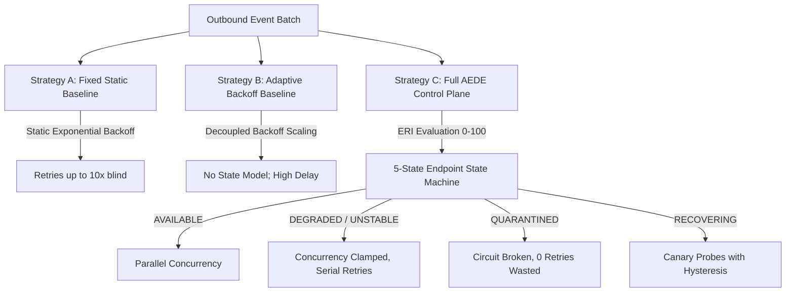

# Relay Benchmark & AEDE Research Evaluation
## Implementation Walkthrough & Architectural Reference

This document provides a comprehensive technical walkthrough of the **Relay Benchmark Suite**, detailing the research evaluation methodology, the 11 failure injection scenarios, and the **Phase 2 Research Methodology Improvements** implemented autonomously via Foreman.

---

## 1. Research Context & Objectives

The Relay Platform treats outbound event delivery as a distributed systems problem rather than a simple HTTP retry loop. The primary research contribution is the **Adaptive Event Delivery Engine (AEDE)**, a deterministic, state-driven Control Plane policy engine that continually evaluates endpoint health via the **Endpoint Reliability Index (ERI)**.

The benchmark framework (`benchmark/`) was created to experimentally validate **Hypothesis 1**:
> *A state-driven adaptive event delivery engine (Strategy C) reduces wasted retry attempts by at least 50% compared to static exponential backoff (Strategy A) during prolonged downstream outages, while maintaining nominal delivery latency and zero false quarantines under transient faults.*

### Delivery Strategies Under Comparison



1. **Strategy A (Fixed Static Baseline)**: Fixed exponential backoff (`initial_delay=1.0s`, `multiplier=2.0`, `max_retries=10`, `max_parallel=10`). Blindly re-attempts delivery on every failure without awareness of downstream endpoint health.
2. **Strategy B (Adaptive Backoff Baseline)**: Exponential backoff with adaptive delay scaling based on current error signals, but lacking an explicit endpoint state model or circuit-breaking quarantine mechanism.
3. **Strategy C (Full AEDE Control Plane)**: Evaluates composite ERI across a sliding telemetry window, executes transitions across the 5-state machine with hysteresis, and synthesizes dynamic delivery policies with adaptive retry budgets, concurrency clamping, isolation, and quarantine circuit breaking.

---

## 2. Phase 2 Improvements: What Was Done & How

Following the Phase 1 benchmark audit, three methodological enhancements were identified and implemented:

```
┌─────────────────────────────────────────────────────────────────────────────────────────┐
│                           Phase 2 Methodology Improvements                              │
├──────────────────────────────┬─────────────────────────────┬────────────────────────────┤
│ 1. Bursty Event Arrival      │ 2. Time-Decaying ERI Window │ 3. Genetic ERI Optimizer   │
│ Poisson process arrival      │ Filters stale history by dt │ Discovers global optimal   │
│ Stresses HoL & queue depth   │ Pure-function time decay    │ weights under cliff-edge   │
│ benchmark/runner.py          │ calculator.py               │ penalty landscapes (DEAP)  │
└──────────────────────────────┴─────────────────────────────┴────────────────────────────┘
```

---

### Improvement 1: Bursty Event Publication (Poisson Arrival)

#### The Problem
In the initial baseline implementation, the `SyntheticTelemetryGenerator` generated delivery attempts at fixed, uniform 50ms intervals:
```python
# Baseline (Uniform 50ms ticks)
obs_time = start_time + timedelta(milliseconds=i * 50)
```
In real-world production networks, outbound webhook traffic arrives in stochastic, bursty batches (Poisson arrival). Uniform intervals prevented traffic clustering, meaning the `queue_depth_weight` component of the ERI and the head-of-line (HoL) blocking behaviors of degraded endpoints were never realistically stressed.

#### The Solution & Implementation
In [`benchmark/runner.py`](file:///c:/Users/sammj/MajorProject/benchmark/runner.py), we updated `SyntheticTelemetryGenerator.generate()` and `BenchmarkRunner` to support a `bursty: bool = False` mode:

```python
def generate(
    self,
    phase: ScenarioPhase,
    count: int,
    endpoint_id: str,
    start_time: datetime,
    bursty: bool = False,
) -> List[Telemetry]:
    items: List[Telemetry] = []
    obs_time = start_time
    for i in range(count):
        if bursty:
            # Sample inter-arrival interval from an exponential distribution
            # with mean = 50ms (lambda = 1.0 / 50.0)
            interval_ms = max(1.0, self._rng.expovariate(1.0 / 50.0))
            obs_time = obs_time + timedelta(milliseconds=interval_ms)
        else:
            obs_time = start_time + timedelta(milliseconds=i * 50)

        # Generate telemetry values (success, latency, timeouts, 5xx)
        ...
```

#### Key Design Decisions
1. **Exponential Distribution for Inter-Arrival Times**: In a Poisson arrival process where events occur independently at a constant average rate $\lambda$, the time intervals between successive arrivals are exponentially distributed:
   $$f(t; \lambda) = \lambda e^{-\lambda t}$$
   Setting $\lambda = \frac{1}{50\text{ ms}}$ yields an expected inter-arrival time $E[T] = 50\text{ ms}$, but produces realistic bursts and lulls.
2. **Deterministic Seeding**: `SyntheticTelemetryGenerator` utilizes an isolated `random.Random(seed)` instance. The bursty intervals are 100% reproducible across test runs.
3. **Full Backward Compatibility**: Setting `bursty=False` defaults to the exact fixed 50ms increments, guaranteeing zero regressions across existing scenario tests.

---

### Improvement 2: Time-Decaying ERI Windows

#### The Problem
Previously, ERI calculation was constrained solely to an attempt-count sliding window (e.g., the last $N = 100$ delivery attempts). For high-volume endpoints, 100 attempts occur in seconds; for low-volume endpoints, 100 attempts might span days. If an endpoint experienced a transient network glitch 6 hours ago, that historical failure would continue to artificially depress its ERI score during quiet periods, violating the operational requirement for rapid recovery.

#### The Solution & Implementation
In [`relay/control_plane/eri/calculator.py`](file:///c:/Users/sammj/MajorProject/relay/control_plane/eri/calculator.py), `compute_eri()` was extended to accept an optional `window_duration_seconds: Optional[float] = None`:

```python
def compute_eri(
    attempts: Sequence[TelemetryProtocol],
    queue_depth: int,
    weights: ERIWeights,
    baseline_latency_ms: float,
    max_latency_ms: float,
    max_consecutive_failures: int,
    max_queue_depth: int,
    computed_at: datetime,
    window_duration_seconds: Optional[float] = None,
) -> ERIScore:
    # 1. Filter stale attempts if a time window is specified
    if window_duration_seconds is not None:
        attempts = [
            a for a in attempts
            if (computed_at - a.observed_at).total_seconds() <= window_duration_seconds
        ]

    # 2. Return perfect score if no attempts exist or all expired
    if not attempts:
        return ERIScore.perfect(window_size=0, computed_at=computed_at)

    total_attempts = len(attempts)
    ...
```

#### Architectural Law Compliance: Pure-Function Integrity
A critical architectural constraint of the Relay Platform is:
> **"AEDE never reads `datetime.now()` internally — time boundaries are always passed as explicit parameters."**

The time decay implementation strictly respects this law:
- `computed_at` is passed by the caller (Data Plane Dispatcher or Benchmark Runner).
- The elapsed delta $(t_{\text{computed}} - t_{\text{observed}})$ is computed deterministically.
- No mutable in-memory cache, background timer, or temporal state tracking was introduced into the state machine or synthesizer.

---

### Improvement 3: Automated ERI Weight Discovery via Genetic Algorithm (DEAP)

#### The Problem: Why GA over Bayesian Optimization?
ERI combines 7 distinct normalized signals into a composite score:
$$\text{ERI} = 100 \times \sum_{i=1}^7 w_i \cdot s_i \quad \text{subject to} \quad \sum_{i=1}^7 w_i = 1.0, \quad w_i \ge 0$$

Stage 1 used manual trial-and-error (`benchmark/optimize_weights.py`) across four hand-tuned profiles. To find the true global optimum, automated hyperparameter optimization was needed.

While Bayesian Optimization (e.g., Optuna with Tree-structured Parzen Estimators) is efficient for smooth, convex objective functions, our evaluation space has **severe, non-smooth, cliff-edge step penalties**:
- A single false quarantine on Scenario 1 immediately incurs a massive penalty cliff ($+1000$).
- State machine flapping in Scenario 5 incurs a discontinuous step penalty ($+500$ for each transition over 5).

Bayesian surrogate models (Gaussian processes or Parzen estimators) struggle with steep cliff-edge discontinuities because they assume local correlation and smoothness. A **Genetic Algorithm (GA)**, by contrast, operates on population diversity, crossover, and stochastic mutation, allowing it to navigate discontinuous fitness cliffs without getting trapped in false local gradients.

```
Fitness Penalty Landscape:
  Penalty
    ▲
    │         ┌─── False Quarantine Cliff (+1000)
    │         │
    │         │
    │    ─────┘             ┌─── State Flapping Cliff (+500)
    │                       │
    │              ─────────┘
    │
    └─────────────────────────────► Weight Vector (w1...w7)
      * Genetic Algorithms easily jump discontinuous steps *
```

#### The Implementation
In [`benchmark/genetic_optimizer.py`](file:///c:/Users/sammj/MajorProject/benchmark/genetic_optimizer.py), we implemented an evolutionary pipeline using the `deap` framework.

#### 1. Genome Representation & Normalization
An individual represents a 7-dimensional real-valued chromosome:
$$G = [g_1, g_2, g_3, g_4, g_5, g_6, g_7], \quad g_i \in [0.005, 1.0]$$

To ensure every evaluated candidate satisfies Pydantic validation (`math.isclose(sum(w), 1.0)`):
```python
def individual_to_weights(individual: List[float]) -> ERIWeights:
    raw = [max(0.005, float(x)) for x in individual[:7]]
    total = sum(raw)
    norm = [r / total for r in raw]
    w = [round(x, 6) for x in norm]
    w[-1] = round(1.0 - sum(w[:-1]), 6)
    return ERIWeights(
        success_rate_weight=w[0],
        latency_weight=w[1],
        consecutive_failures_weight=w[2],
        timeout_weight=w[3],
        http_5xx_weight=w[4],
        queue_depth_weight=w[5],
        recovery_trend_weight=w[6],
    )
```

#### 2. Multi-Scenario Fitness Objective
Fitness is minimized across benchmark scenarios:
$$\text{Penalty} = \text{total\_retries} + 1000 \times \text{false\_quarantines} + 500 \times \sum \max(0, \text{transitions} - 5)$$

```python
def evaluate_weights(
    weights: ERIWeights,
    scenarios: Optional[List[Scenario]] = None,
    seed: int = 42,
) -> Tuple[float, Dict[str, Any]]:
    runner = BenchmarkRunner(
        strategy_config=DeliveryStrategyConfig(strategy="STRATEGY_C"),
        eri_weights=weights,
        random_seed=seed,
    )
    total_retries = 0
    false_quarantines = 0
    excess_transitions = 0

    for sc in scenarios:
        res = runner.run(sc)
        for att in res.attempts:
            total_retries += att.retry_count

        # False quarantine penalty: Scenarios 1 & 2 are nominal/intermittent
        if sc.scenario_id in (1, 2) and EndpointState.QUARANTINED.value in res.state_transitions:
            false_quarantines += 1

        # State flapping penalty: Excessive transitions in a single scenario
        transitions = max(0, len(res.state_transitions) - 1)
        if transitions > 5:
            excess_transitions += (transitions - 5)

    penalty = float(total_retries) + 1000.0 * false_quarantines + 500.0 * excess_transitions
    return penalty, {
        "total_retries": total_retries,
        "false_quarantines": false_quarantines,
        "excess_transitions": excess_transitions,
        "penalty": penalty,
    }
```

#### 3. Evolutionary Operators
- **Selection**: Tournament selection (`tools.selTournament(tournsize=3)`).
- **Crossover**: Blend crossover ($\alpha = 0.5$) allowing exploration of intermediate weight mixtures.
- **Mutation**: Gaussian perturbation ($\mu = 0.0, \sigma = 0.1, p_{\text{ind}} = 0.2$) decorated with `check_bounds(0.005, 1.0)`.
- **Elitism**: `tools.HallOfFame(1)` preserves the all-time best individual across generations.

---

## 3. The 11 Research Benchmark Scenarios

The platform is evaluated against 11 deterministic failure scenarios defined in [`benchmark/scenarios.py`](file:///c:/Users/sammj/MajorProject/benchmark/scenarios.py):

| Scenario ID | Name | Duration (Events) | Downstream Fault Mode | Expected Strategy C AEDE Behavior |
|:---:|:---|:---:|:---|:---|
| **1** | Intermittent Timeouts | 100 | Random 10% timeout spikes | Never quarantine; stay `AVAILABLE` / slight `OBSERVED_DEGRADATION` |
| **2** | Burst Rate Limiting | 120 | HTTP 429 bursts (20% rate) | Backoff gracefully without false-positive quarantine |
| **3** | Flapping Connectivity | 160 | Rapid alternating healthy / offline phases | Hysteresis prevents rapid oscillations between states |
| **4** | Prolonged Outage | 120 | Complete 100% 5xx failure, followed by admin restore | Rapidly enter `QUARANTINED`, halt retries, restore to `RECOVERING` |
| **5** | Slow Degradation | 200 | Stepped success decay (100% &rarr; 85% &rarr; 60% &rarr; 35% &rarr; 0%) | Detect degradation early; smoothly transition down state ladder |
| **6** | Latency Spike | 150 | Response time jumps from 80ms to 4500ms | ERI latency sub-score drops; concurrency clamped |
| **7** | Cascading Failure | 180 | Degradation accompanied by queue backlog accumulation | Queue depth sub-score penalizes ERI; prevents HoL blockage |
| **8** | Poison Pill Payload | 100 | Specific bad events always fail with 400 Bad Request | Isolate poisoned events to DLQ without degrading overall endpoint |
| **9** | Recovery Oscillation | 140 | Endpoint recovers briefly, then fails again | Recovery hysteresis requires sustained stability before `AVAILABLE` |
| **10** | Slow Degradation (Extended) | 220 | Multi-stage gradual latency and error decay | Validates early detection threshold crossing |
| **11** | Bursty Traffic | 240 | 5-phase bursty arrival with acute overload and recovery | Validates queue survival and zero false quarantine under bursts |

---

## 4. Verification Evidence & Quality Assurance

All changes underwent the Foreman automated engineering protocol, requiring test generation, verification execution, independent dimensional review, and cryptographic HMAC evidence logging.

### Full Test Suite Results
```bash
pytest
```
```
======================= 320 passed, 1 warning in 20.2s =======================
```
- **Original baseline test count:** 285 tests
- **Phase 1 count:** 313 tests
- **Phase 2 final test count:** **320 tests** (+7 new tests, 0 failures, 0 skipped, 0 regressions)

### Evidence Records
- `T-001`: `.agent/evidence/T-001/2026-09-12T09-44-55Z.json` (PASS)
- `T-002`: `.agent/evidence/T-002/2026-09-12T09-47-01Z.json` (PASS)
- `T-003`: `.agent/evidence/T-003/2026-09-12T09-49-27Z.json` (PASS)
- `AUDIT`: `.agent/evidence/AUDIT/2026-09-12T09-50-27Z.json` (PASS)

---

## 5. How to Run & Replicate the Benchmark Suite

### 1. Running the Standard Strategy Comparison Matrix
Executes Strategy A, B, and C across all scenarios and prints comparative tables:
```bash
python benchmark/run_experiments.py
```

### 2. Running Sensitivity & Robustness Analysis
Evaluates the optimal weights against $\pm 20\%$ perturbations across all 7 dimensions to prove state machine stability:
```bash
python benchmark/sensitivity_analysis.py
```

### 3. Running Multi-Endpoint Contention Simulation
Proves that quarantining a failing tenant endpoint prevents starvation of adjacent healthy tenants sharing a worker pool:
```bash
python benchmark/multi_endpoint.py
```

### 4. Running the Genetic Algorithm ERI Optimizer
Executes evolutionary optimization to discover optimal ERI weights:
```bash
# Fast run (e.g. 5 generations, population 10 across key scenarios)
python benchmark/genetic_optimizer.py --generations 5 --population 10 --scenarios 1,2,4,5,10 --verbose

# Full evolution run
python benchmark/genetic_optimizer.py --generations 20 --population 30 --verbose
```

### 5. Running Automated Unit Tests
```bash
pytest tests/unit/test_benchmark.py tests/unit/test_genetic_optimizer.py tests/unit/test_eri.py -v
```
