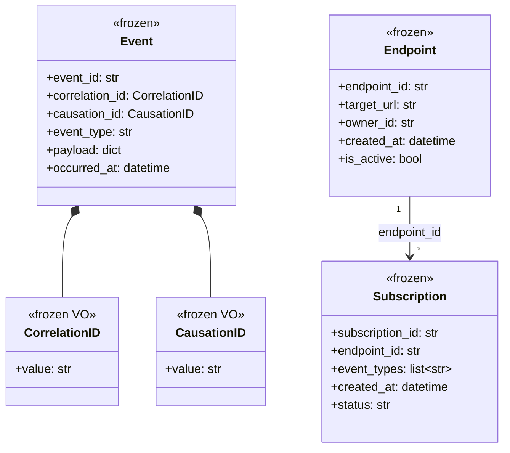
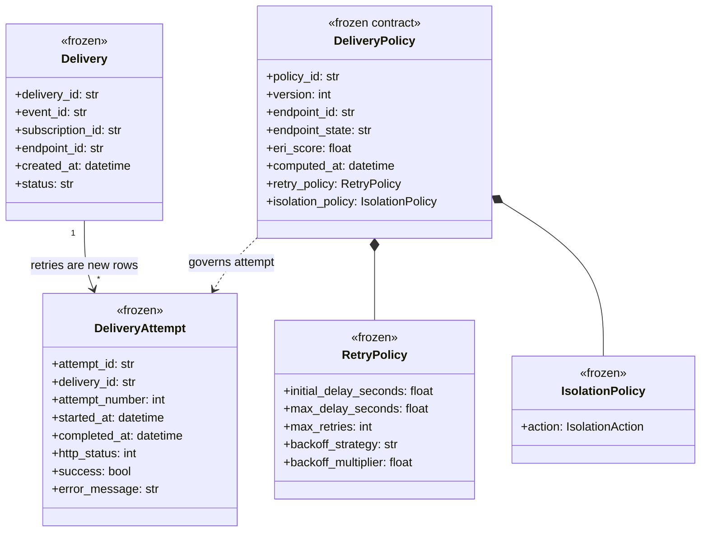
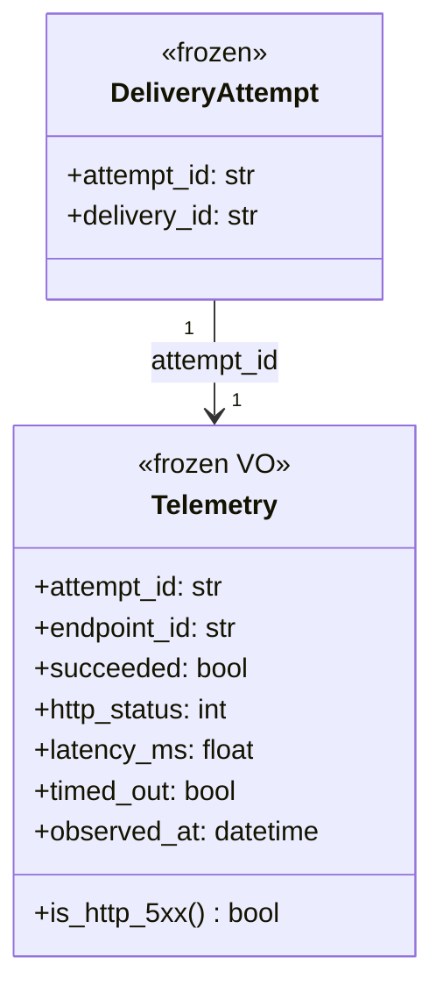
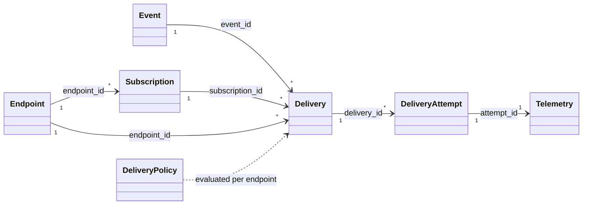

# Data Plane — Domain Model (Weeks 1–4)

Frozen Pydantic types (`relay/kernel/`). IDs are associations, not nested objects, except `Event` composing `CorrelationID` / `CausationID`. One `Delivery` per `(event_id, subscription_id)`. Each retry is a new `DeliveryAttempt`. `Telemetry` is 1:1 with an attempt (`attempt_id` PK). `DeliveryPolicy` is the Control Plane contract (ADR 0005); Week 3–4 produces it via `StrategyA`.

---

## Core

Configuration and ingested facts.

---

## Execution

Fan-out lifecycle and the policy workers execute.

`Delivery.status`: `PENDING` | `SUCCESS` | `FAILED` | `DEAD_LETTER`. Unique `(event_id, subscription_id)`.

`RetryPolicy` (Strategy A): EXPONENTIAL, `initial_delay_seconds=5`, `backoff_multiplier=2`, `max_delay_seconds=300`, `max_retries=10`.

`IsolationAction`: `CONTINUE` | `REDUCE_CONCURRENCY` | `PAUSE` | `QUARANTINE`. `PAUSE` / `QUARANTINE` skip HTTP; Delivery stays `PENDING`.

---

## Observability

ERI input. Not a `DeliveryAttempt`. PK is `attempt_id`.

---

## Cardinality map

