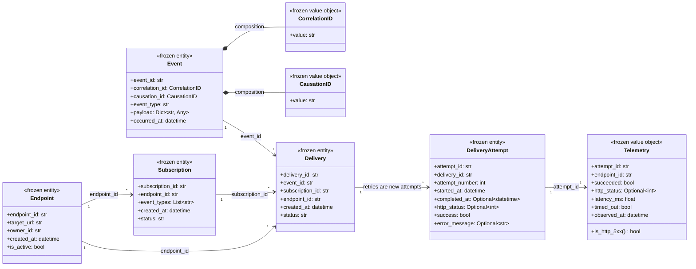
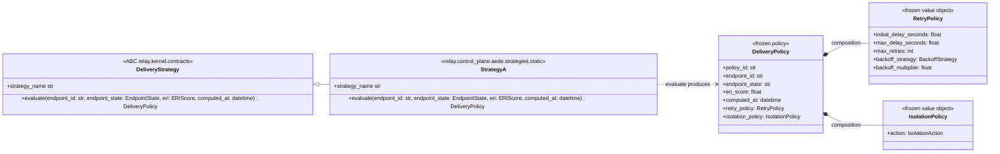
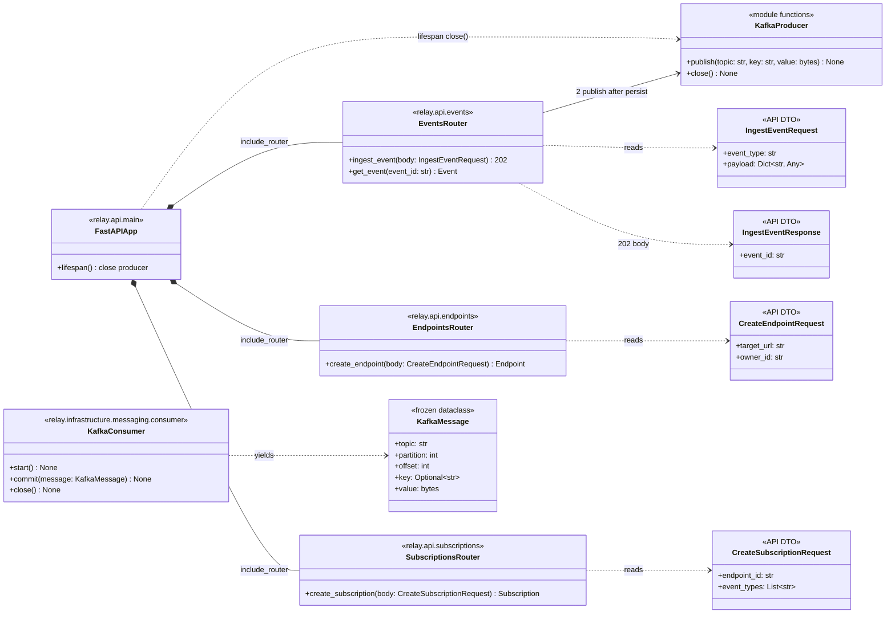

# Data Plane — UML Class Diagrams

Core structure of the Relay Data Plane, split by layer so each diagram stays readable.

Sources: `relay/kernel/entities/`, `relay/kernel/value_objects/`, `relay/kernel/policies/`, `relay/kernel/contracts/`, `relay/infrastructure/persistence/`, `relay/infrastructure/messaging/`, `relay/api/`, `relay/data_plane/`, Week 1–4 contracts in `docs/sprints/`.

---

## Domain Model

Entities and value objects (`relay/kernel/`). `Delivery` is one row per `(event_id, subscription_id)`. Each retry is a new `DeliveryAttempt`. `Telemetry` is a 1:1 ERI observation keyed by `attempt_id` — not a fourth telemetry shape.

---

## Control Plane contracts (consumed by Data Plane)

Interfaces the Dispatcher calls. Week 3–4 always uses `StrategyA` (`STATIC_RETRY_MODE`). Workers never compute policy. `evaluate()` receives `computed_at` from the caller — never `datetime.now()` inside strategy selection.

---

## Persistence Layer

Repositories, SQLAlchemy tables, and the engine/config they sit on. Repositories map frozen kernel entities ↔ table rows; nothing outside this package should import the tables.

```mermaid
classDiagram
    direction LR

    class DatabaseConfig {
        <<module functions>>
        +get_sync_database_url() str
        +get_async_database_url() str
    }

    class PersistenceEngine {
        <<module functions>>
        +get_engine() AsyncEngine
    }

    class EventRepository {
        <<append-only>>
        +save(event: Event) None
        +get_by_id(event_id: str) Event | None
    }

    class EndpointRepository {
        <<upsert>>
        +save(endpoint: Endpoint) None
        +get_by_id(endpoint_id: str) Endpoint | None
    }

    class SubscriptionRepository {
        <<upsert>>
        +save(subscription: Subscription) None
        +get_by_id(subscription_id: str) Subscription | None
        +list_active_by_event_type(event_type: str) List~Subscription~
    }

    class DeliveryRepository {
        <<lifecycle upsert>>
        +save(delivery: Delivery) None
        +get_by_id(delivery_id: str) Delivery | None
        +get_by_event_and_subscription(event_id: str, subscription_id: str) Delivery | None
    }

    class DeliveryAttemptRepository {
        <<insert then complete>>
        +save(attempt: DeliveryAttempt) None
        +get_by_id(attempt_id: str) DeliveryAttempt | None
        +list_by_delivery_id(delivery_id: str) List~DeliveryAttempt~
    }

    class TelemetryRepository {
        <<append-only>>
        +save(telemetry: Telemetry) None
        +get_by_id(attempt_id: str) Telemetry | None
        +list_by_endpoint_id(endpoint_id: str) List~Telemetry~
    }

    class events_table {
        <<SQLAlchemy Table>>
        +event_id: UUID PK
        +correlation_id: UUID
        +causation_id: UUID
        +event_type: String
        +payload: JSONB
        +occurred_at: timestamptz
    }

    class endpoints_table {
        <<SQLAlchemy Table>>
        +endpoint_id: UUID PK
        +target_url: String
        +owner_id: String
        +created_at: timestamptz
        +is_active: Boolean
    }

    class subscriptions_table {
        <<SQLAlchemy Table>>
        +subscription_id: UUID PK
        +endpoint_id: UUID FK
        +event_types: ARRAY~String~
        +created_at: timestamptz
        +status: String
    }

    class deliveries_table {
        <<SQLAlchemy Table>>
        +delivery_id: UUID PK
        +event_id: UUID FK
        +subscription_id: UUID FK
        +endpoint_id: UUID FK
        +created_at: timestamptz
        +status: String
    }

    class delivery_attempts_table {
        <<SQLAlchemy Table>>
        +attempt_id: UUID PK
        +delivery_id: UUID FK
        +attempt_number: Integer
        +started_at: timestamptz
        +completed_at: timestamptz
        +http_status: Integer
        +success: Boolean
        +error_message: Text
    }

    class telemetry_table {
        <<SQLAlchemy Table>>
        +attempt_id: UUID PK FK
        +endpoint_id: UUID FK
        +succeeded: Boolean
        +http_status: Integer
        +latency_ms: Float
        +timed_out: Boolean
        +observed_at: timestamptz
    }

    PersistenceEngine ..> DatabaseConfig : async URL
    EventRepository ..> PersistenceEngine : get_engine
    EventRepository ..> events_table : INSERT ON CONFLICT DO NOTHING
    EndpointRepository ..> PersistenceEngine : get_engine
    EndpointRepository ..> endpoints_table : UPSERT
    SubscriptionRepository ..> PersistenceEngine : get_engine
    SubscriptionRepository ..> subscriptions_table : UPSERT
    DeliveryRepository ..> PersistenceEngine : get_engine
    DeliveryRepository ..> deliveries_table : UPSERT status on same delivery_id
    DeliveryAttemptRepository ..> PersistenceEngine : get_engine
    DeliveryAttemptRepository ..> delivery_attempts_table : INSERT then complete
    TelemetryRepository ..> PersistenceEngine : get_engine
    TelemetryRepository ..> telemetry_table : INSERT ON CONFLICT DO NOTHING
    subscriptions_table --> endpoints_table : FK endpoint_id
    deliveries_table --> events_table : FK event_id
    deliveries_table --> subscriptions_table : FK subscription_id
    deliveries_table --> endpoints_table : FK endpoint_id
    delivery_attempts_table --> deliveries_table : FK delivery_id
    telemetry_table --> delivery_attempts_table : FK attempt_id PK
    telemetry_table --> endpoints_table : FK endpoint_id
```

---

## API and Messaging Layer

FastAPI app, routers, request/response DTOs, and the Kafka wrappers. Routers never import `aiokafka`. Persist-first: Events router saves via `EventRepository`, then `publish()`. Dispatcher never imports `aiokafka` either — it uses `KafkaConsumer`.

---

## Data Plane execution

Dispatcher, webhook worker, and Retry Manager. Offset commit is after Postgres, never after HTTP. Worker does not compute backoff. Retry Manager applies `DeliveryPolicy.retry_policy` fields (EXPONENTIAL: 5s, ×2, cap 300s, max 10) and publishes `RetryWork` to `events.internal.delivery`.

```mermaid
classDiagram
    direction LR

    class Dispatcher {
        <<relay.data_plane.dispatcher>>
        +run() None
        +handle_message(message: KafkaMessage) None
        +handle_retry(message: KafkaMessage) None
    }

    class WebhookWorker {
        <<relay.data_plane.workers.webhook>>
        +execute(attempt: DeliveryAttempt, target_url: str, endpoint_id: str) tuple~DeliveryAttempt, Telemetry~
    }

    class RetryManager {
        <<relay.data_plane.retry_manager>>
        +handle(completed: DeliveryAttempt, delivery: Delivery, policy: DeliveryPolicy) RetryWork | None
    }

    class RetryWork {
        <<Kafka DTO>>
        +next_attempt_at: datetime
        +attempt: DeliveryAttempt
        +delivery: Delivery
        +policy: DeliveryPolicy
    }

    Dispatcher --> WebhookWorker : execute
    Dispatcher ..> RetryWork : handle_retry
    WebhookWorker --> RetryManager : handle after HTTP
    RetryManager ..> RetryWork : payload
```

---

## Implementation status

| Layer | Status |
|---|---|
| Domain entities + `CorrelationID` / `CausationID` | Implemented, `frozen=True` |
| `Telemetry` VO | Implemented in `relay/kernel/value_objects/telemetry.py` |
| `DeliveryPolicy` + `DeliveryStrategy` / `StrategyA` | Implemented (kernel + `control_plane/aede/strategies/static.py`) |
| `events_table` / `endpoints_table` / `subscriptions_table` + Alembic | Implemented |
| `deliveries_table` / `delivery_attempts_table` / `telemetry_table` + Alembic | Implemented |
| `DatabaseConfig` + `PersistenceEngine.get_engine()` | Implemented |
| `EventRepository` | Implemented — append-only `save()` (`ON CONFLICT DO NOTHING`) + `get_by_id()` |
| `EndpointRepository` / `SubscriptionRepository` | Implemented — upsert `save()` + `get_by_id()`; `list_active_by_event_type()` |
| `DeliveryRepository` / `DeliveryAttemptRepository` / `TelemetryRepository` | Implemented |
| Kafka wrapper `publish()` / `close()` | Implemented in `relay/infrastructure/messaging/producer.py` |
| Kafka wrapper `KafkaConsumer` | Implemented in `relay/infrastructure/messaging/consumer.py` |
| FastAPI app + routers | Implemented in `relay/api/` (`main`, `events`, `endpoints`, `subscriptions`) |
| Request DTOs | Implemented in `relay/api/schemas.py` |
| `Dispatcher` / `WebhookWorker` / `RetryManager` | Implemented in `relay/data_plane/` |

## Relationship rules

- Value objects are **composition** on `Event` (nested Pydantic objects, not FK strings).
- `Subscription` / `Delivery` / `DeliveryAttempt` / `Telemetry` hold **ID associations**, not nested entities.
- API request bodies are **DTOs**, not domain entities. `IngestEventRequest` is only `event_type` + `payload`; the router builds `CorrelationID` / `CausationID` / `Event`.
- Ingestion is **persist-first**: `EventsRouter` → `EventRepository.save` → `KafkaProducer.publish` (`topic=events.business`, `key=event_id`) → HTTP 202. Kafka is not called unless Postgres committed. 202 is not returned if Kafka then fails (503, `event_id` in the body). No HTTP/Kafka retry in the route (ADR 0005).
- Routers never import `aiokafka`; they call `publish()` / `close()` on the wrapper only. Dispatcher uses `KafkaConsumer` only.
- `EventRepository` has no `update()` — append-only, matching ADR 0011.
- `EndpointRepository` / `SubscriptionRepository` `save()` **upserts**. Config entities change via `model_copy(update=...)` + re-save. `subscriptions.endpoint_id` is an FK to `endpoints`.
- `SubscriptionsRouter` resolves `endpoint_id` through `EndpointRepository` before insert (404 if missing).
- Fan-out: one `Event` × N ACTIVE `Subscription`s → N `Delivery` rows (unique `(event_id, subscription_id)`).
- `Delivery` `"1"` → `"*"` `DeliveryAttempt` (each retry is a new attempt). `DeliveryAttempt` `"1"` → `"1"` `Telemetry` via `attempt_id`.
- Dispatcher: persist `Delivery` + initial `DeliveryAttempt` → `StrategyA.evaluate(...)` → HTTP. Commit Kafka offset **after** Postgres, not after HTTP.
- `PAUSE` / `QUARANTINE` → no HTTP; Delivery stays durable.
- Worker POSTs once, then `model_copy` + save completed attempt + `Telemetry`. No backoff in the worker.
- Retry Manager reads `policy.retry_policy` (EXPONENTIAL 5s, multiplier 2, cap 300s, max 10). New attempt row, then `publish` to `events.internal.delivery`. No in-process `sleep` in Retry Manager.
