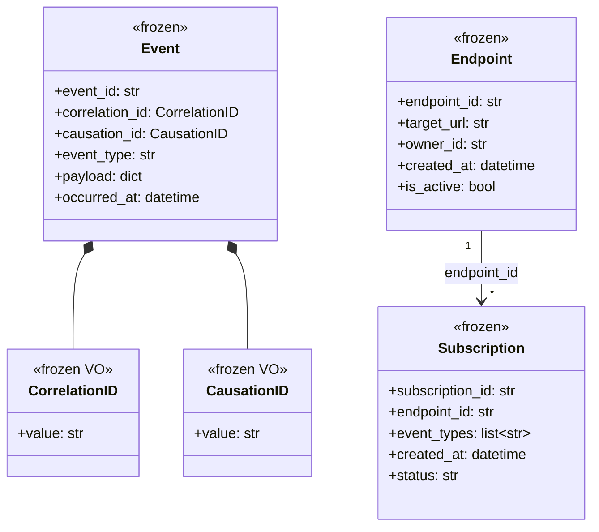
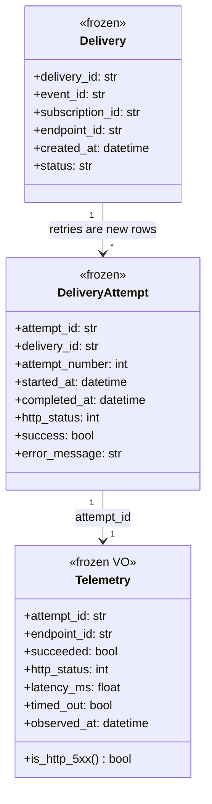
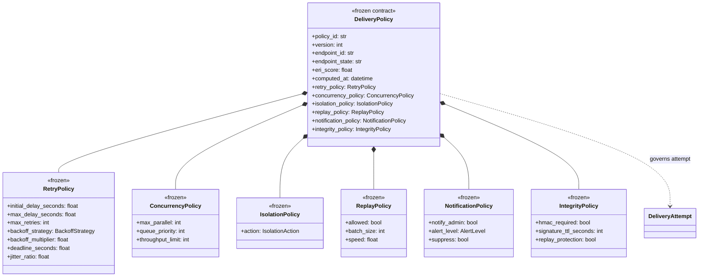
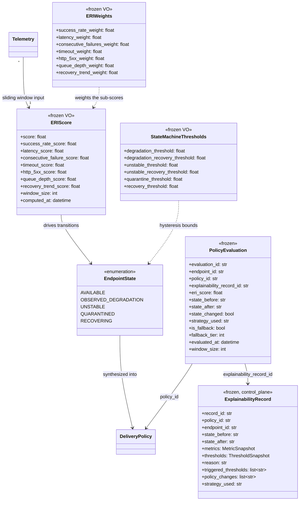
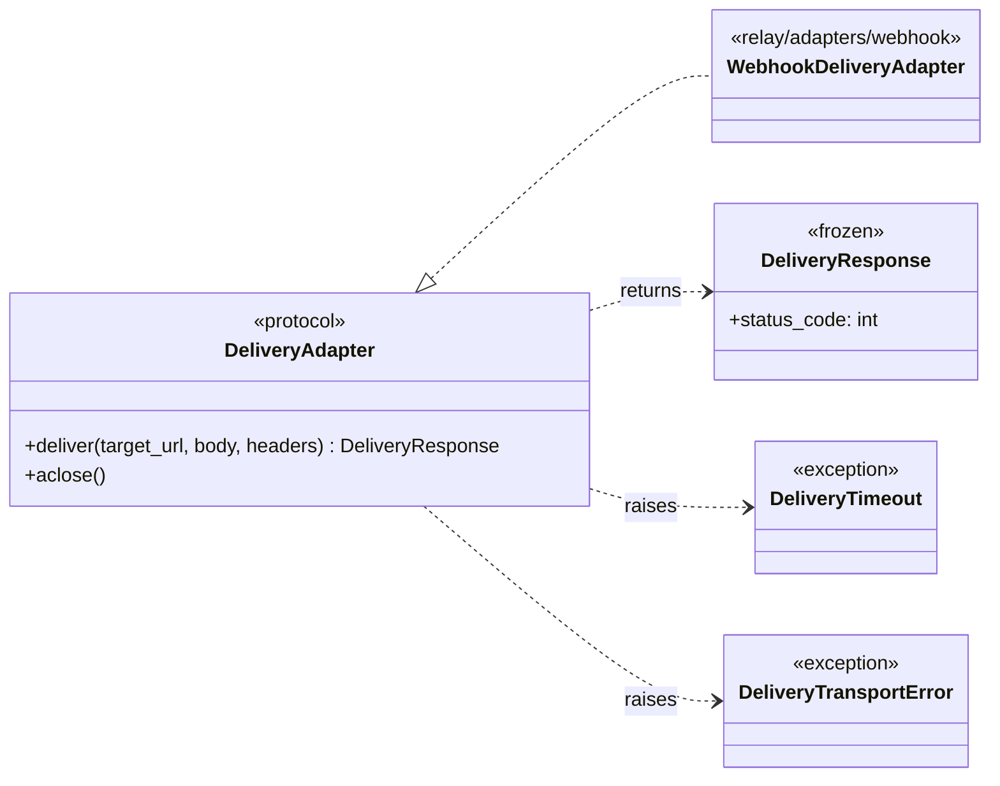
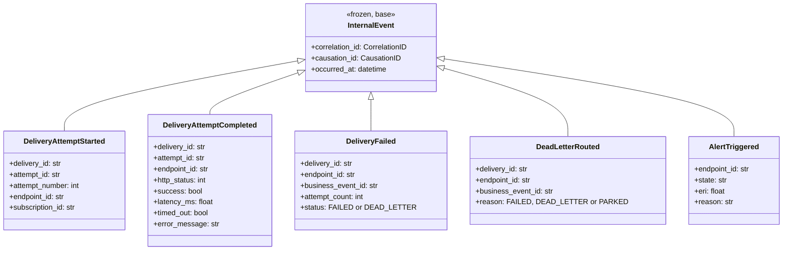
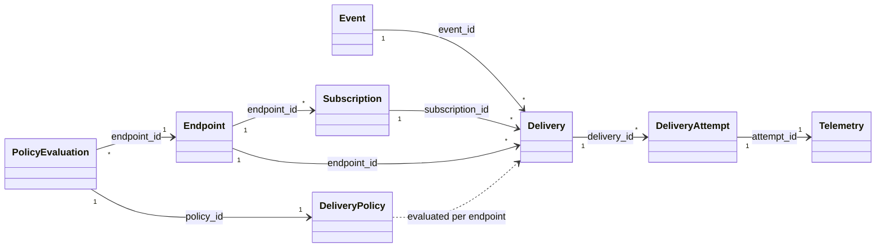

# Relay — Domain Model

Frozen Pydantic types (ADR 0010). IDs are associations, not nested objects, except `Event` composing `CorrelationID` / `CausationID`. One `Delivery` per `(event_id, subscription_id)`. Each retry is a new `DeliveryAttempt`. `Telemetry` is 1:1 with an attempt (`attempt_id` PK). `DeliveryPolicy` is the Control Plane contract (ADR 0005), produced by AEDE and consumed, not interpreted, by the Data Plane.

Types live in `relay/kernel/` unless a section says otherwise.

---

## Core

Configuration and ingested facts.

---

## Execution

Fan-out lifecycle.

`Delivery.status`: `PENDING` | `SUCCESS` | `FAILED` | `DEAD_LETTER`. Unique `(event_id, subscription_id)`. `deliveries` is a mutable lifecycle aggregate; attempts and telemetry are immutable facts (ADR 0014, 0019).

A **parked** delivery is `PENDING` with no attempt row, left behind when the isolation action skipped HTTP. Together with `FAILED` and `DEAD_LETTER` it forms the DLQ that replay works from (ADR 0021). Replay never edits the original rows.

---

## Policy

The contract the Control Plane hands to the Data Plane. Workers execute it mechanically.

`BackoffStrategy`: `FIXED` | `LINEAR` | `EXPONENTIAL`. The static baseline (Strategy A) is EXPONENTIAL, 5 s initial, ×2, capped at 300 s, 10 retries.

`IsolationAction`: `CONTINUE` | `REDUCE_CONCURRENCY` | `PAUSE` | `QUARANTINE`. `PAUSE` and `QUARANTINE` skip HTTP; the Delivery stays `PENDING` (parked).

`IntegrityPolicy.hmac_required` is set from `RELAY_HMAC_REQUIRED`, read once at process start and passed to the synthesizer as an explicit parameter, so synthesis stays deterministic. When true, the worker signs with `X-Relay-Signature`, `X-Relay-Timestamp` and `X-Relay-Nonce`.

`ReplayPolicy.allowed` governs automatic replay. Operator replay is gated by the isolation action only (ADR 0021).

---

## Control Plane records

What AEDE computes from telemetry, and the audit trail it leaves.

ERI is a 0–100 composite of seven normalised sub-scores. Its window is attempt-count only (ADR 0009). AEDE takes `computed_at` as a parameter instead of reading the clock, so evaluation is deterministic and testable.

`ExplainabilityRecord` is not a kernel type: it lives in `relay/control_plane/explainability/record.py`. Records are held in memory today and are not persisted to Postgres.

`PolicyEvaluation.fallback_tier`: 1 = live AEDE, 2 = cached policy, 3 = static Strategy A defaults. `strategy_used`: `STRATEGY_A`, `STRATEGY_B` or `STRATEGY_C`.

---

## Transport

How the worker sends, without knowing the transport.

The protocol sits in `relay/kernel/interfaces/` with no HTTP library behind it; only `WebhookDeliveryAdapter` depends on `httpx`. An adapter performs exactly one send. Signing, target checks and interpreting the response belong to the worker, the SSRF guard and the retry manager.

---

## Internal events

Typed internal event models (`relay/kernel/events/`). These are domain types only: the pipeline does not yet publish them on Kafka.

Policy, endpoint and replay event types are added separately and will subclass `InternalEvent` as well.

---

## Cardinality map

