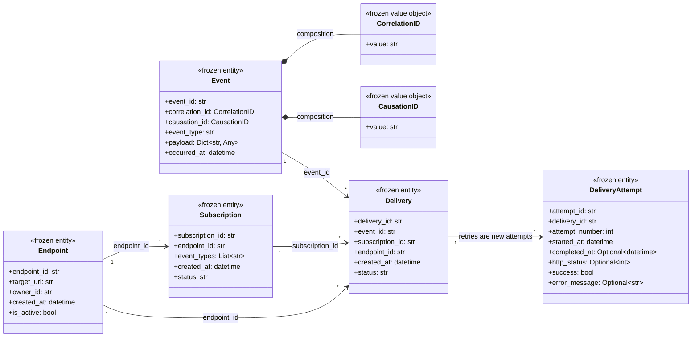
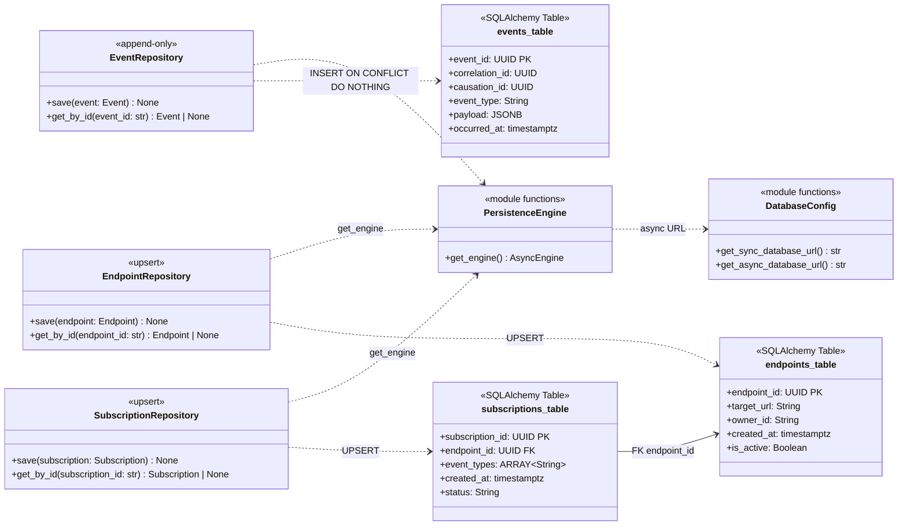
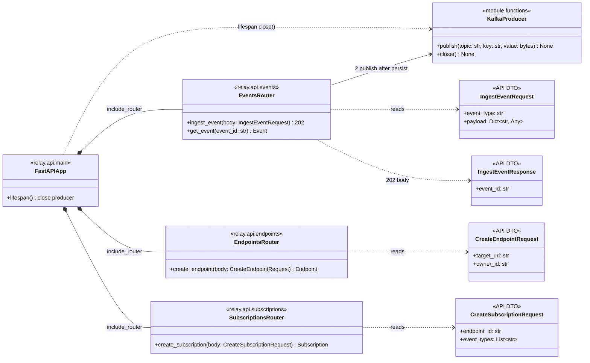

# Data Plane — UML Class Diagrams

Core structure of the Relay Data Plane, split by layer so each diagram stays readable.

Sources: `relay/kernel/entities/`, `relay/kernel/value_objects/identifiers.py`, `relay/infrastructure/persistence/`, `relay/api/`, Week 1–2 contracts in `docs/sprints/week-1-2.md`.

---

## Domain Model

Entities and value objects only (`relay/kernel/`). `Delivery` / `DeliveryAttempt` are kernel types for later dispatcher/worker work; they are not persisted in Weeks 1–2.

---

## Persistence Layer

Repositories, SQLAlchemy tables, and the engine/config they sit on. Repositories map frozen kernel entities ↔ table rows; nothing outside this package should import the tables.

---

## API and Messaging Layer

FastAPI app, routers, request/response DTOs, and the Kafka producer wrapper. Routers never import `aiokafka`. Persist-first: Events router saves via `EventRepository`, then `publish()`.

---

## Implementation status

| Layer | Status |
|---|---|
| Domain entities + `CorrelationID` / `CausationID` | Implemented, `frozen=True` |
| `events_table` / `endpoints_table` / `subscriptions_table` + Alembic | Implemented |
| `DatabaseConfig` + `PersistenceEngine.get_engine()` | Implemented |
| `EventRepository` | Implemented — append-only `save()` (`ON CONFLICT DO NOTHING`) + `get_by_id()` |
| `EndpointRepository` / `SubscriptionRepository` | Implemented — upsert `save()` + `get_by_id()` |
| Kafka wrapper `publish()` / `close()` | Implemented in `relay/infrastructure/messaging/producer.py` |
| FastAPI app + routers | Implemented in `relay/api/` (`main`, `events`, `endpoints`, `subscriptions`) |
| Request DTOs | Implemented in `relay/api/schemas.py` |
| `Delivery` / `DeliveryAttempt` persistence | Not in Week 1–2 ingestion path |

## Relationship rules

- Value objects are **composition** on `Event` (nested Pydantic objects, not FK strings).
- `Subscription` / `Delivery` / `DeliveryAttempt` hold **ID associations**, not nested entities.
- API request bodies are **DTOs**, not domain entities. `IngestEventRequest` is only `event_type` + `payload`; the router builds `CorrelationID` / `CausationID` / `Event`.
- Ingestion is **persist-first**: `EventsRouter` → `EventRepository.save` → `KafkaProducer.publish` (`topic=events.business`, `key=event_id`) → HTTP 202. Kafka is not called unless Postgres committed. 202 is not returned if Kafka then fails (503, `event_id` in the body). No HTTP/Kafka retry in the route (ADR 0005).
- Routers never import `aiokafka`; they call `publish()` / `close()` on the wrapper only.
- `EventRepository` has no `update()` — append-only, matching ADR 0011.
- `EndpointRepository` / `SubscriptionRepository` `save()` **upserts**. Config entities change via `model_copy(update=...)` + re-save. `subscriptions.endpoint_id` is an FK to `endpoints`.
- `SubscriptionsRouter` resolves `endpoint_id` through `EndpointRepository` before insert (404 if missing).
- `Delivery` / `DeliveryAttempt` are kernel entities for later Data Plane work (dispatcher/workers). They are not persisted in the Week 1–2 ingestion path.
