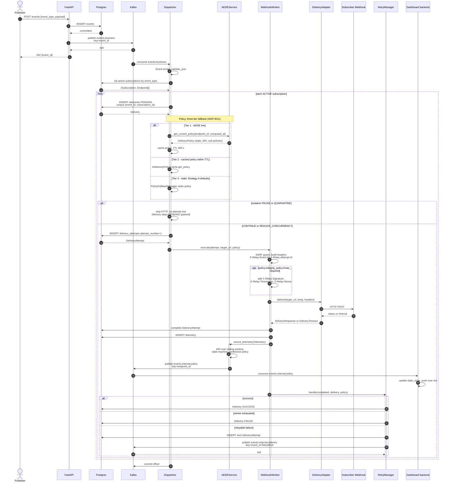
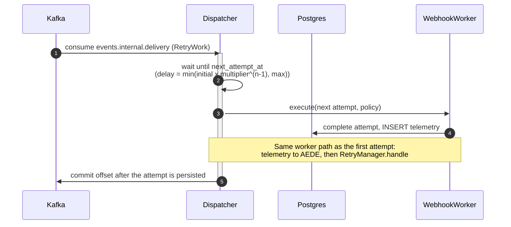
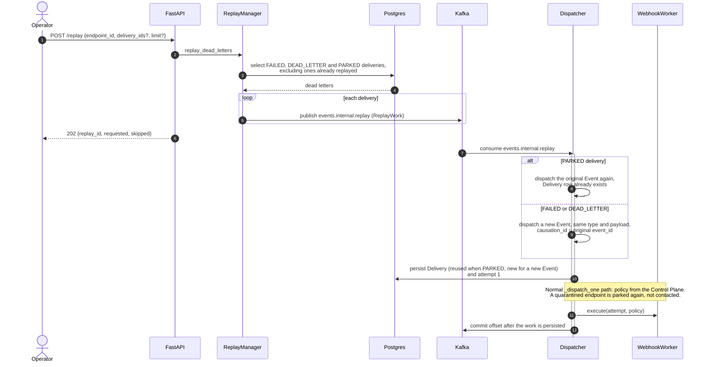
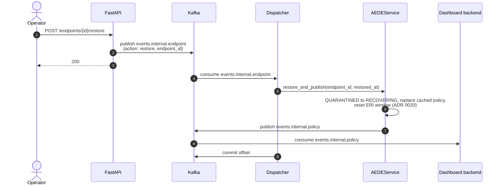

# Data Plane — End-to-End Sequences

Persist-first (ADR 0001, 0002): Postgres before Kafka on ingest, `Delivery` and attempt before HTTP on dispatch, Kafka offset after Postgres and never after HTTP. The Worker does not compute backoff or choose a strategy: the policy it receives already says what to do (ADR 0005). Retry Manager applies `retry_policy` fields and publishes `events.internal.delivery`.

Four flows share these participants: [ingest and delivery](#1-ingest-and-first-delivery), [retry](#2-retry), [replay from the DLQ](#3-replay-from-the-dlq) and [operator restore](#4-operator-restore).

---

## 1. Ingest and first delivery

**Policy source.** With `AEDE_ENABLED=true` the dispatcher's `run()` builds an `AEDEService`, so Tier 1 is always the live AEDE policy. `STATIC_RETRY_MODE` and `ADAPTIVE_RETRY_MODE` only pick the strategy object (Strategy A or B) used when a dispatcher has no `AEDEService`; they do not change the policy source of the shipped process. With `AEDE_ENABLED=false` there is no Tier 1 at all and the policy comes from the cache, then the static Strategy A defaults. A Tier 1 failure falls through to Tier 2, then Tier 3.

**Parked deliveries.** A `PENDING` delivery with no attempt row, left behind by `PAUSE` or `QUARANTINE`, is what the DLQ calls `PARKED` (ADR 0021). Nothing re-dispatches it automatically; operator replay does.

**Metrics.** The dispatcher is the process that records attempts, ERI and state. Its Prometheus exporter listens on `RELAY_METRICS_PORT` (default 9100) once `start_metrics_server()` is called at startup. That call is not wired yet, so the dispatcher currently exports nothing and the Prometheus `dispatcher` target is down.

---

## 2. Retry

The wait lives in the Dispatcher only; the Worker and the Retry Manager never sleep. A crash during the wait leaves the offset uncommitted, so the retry is redelivered instead of dropped.

---

## 3. Replay from the DLQ

Original delivery, attempt and telemetry rows are never modified (ADR 0021). A repeat replay of the same delivery is refused.

---

## 4. Operator restore

