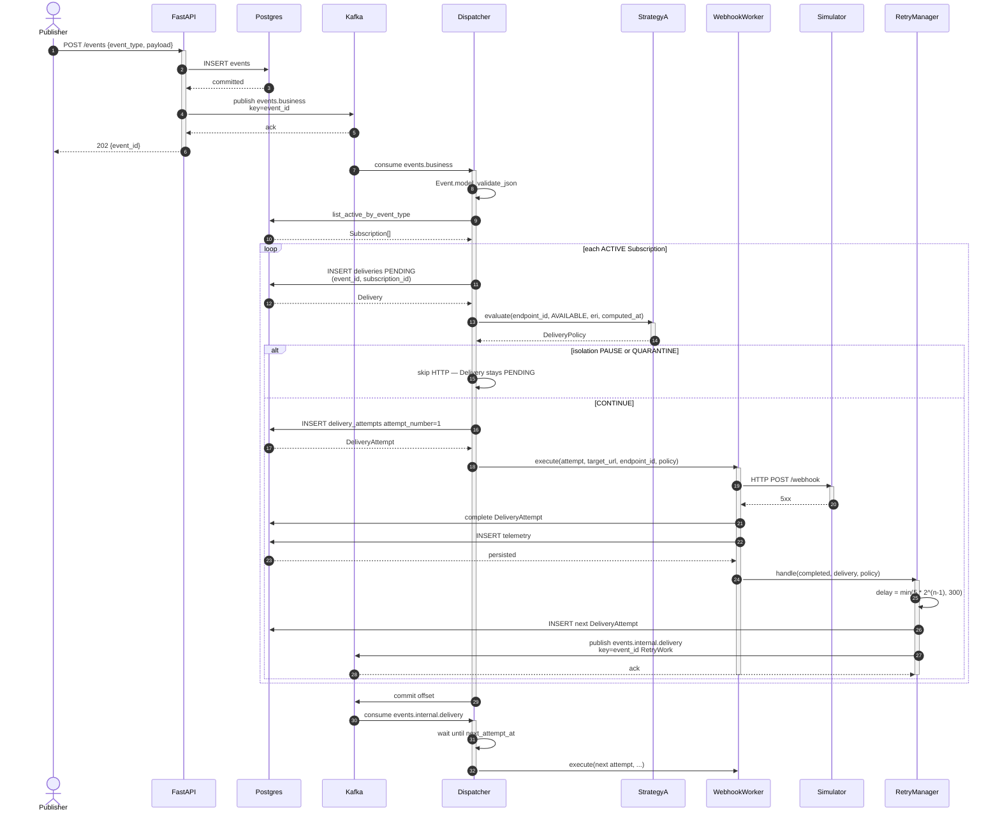

# Data Plane — End-to-End Sequence (Weeks 1–4)

Persist-first (ADR 0001, 0002): Postgres before Kafka on ingest; Delivery + attempt before HTTP on dispatch; Kafka offset after Postgres, never after HTTP. Policy is Strategy A (ADR 0005). Worker does not compute backoff. Retry Manager applies `retry_policy` fields and publishes `events.internal.delivery`.

