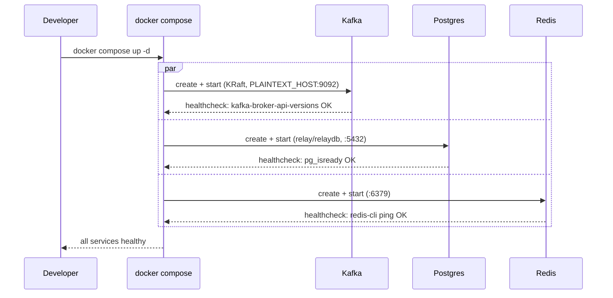
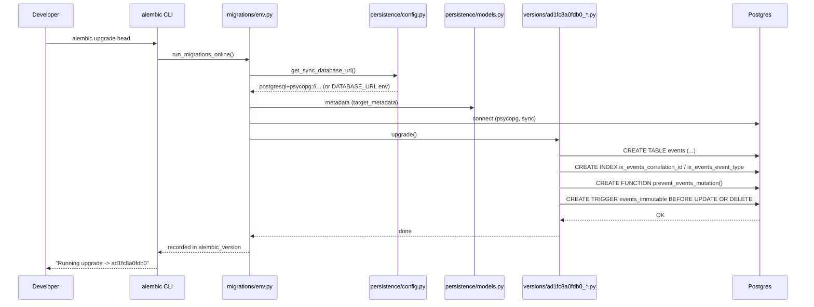
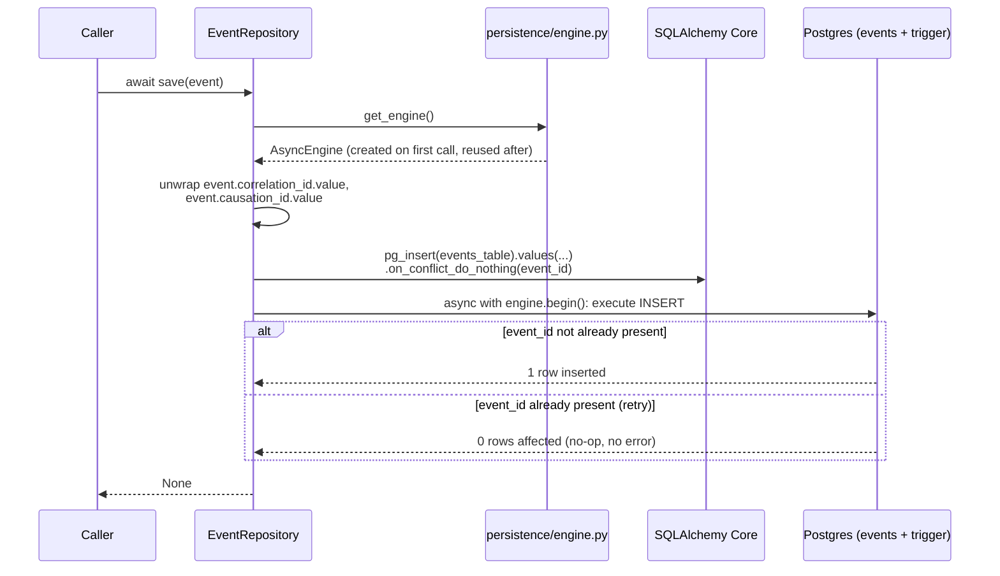
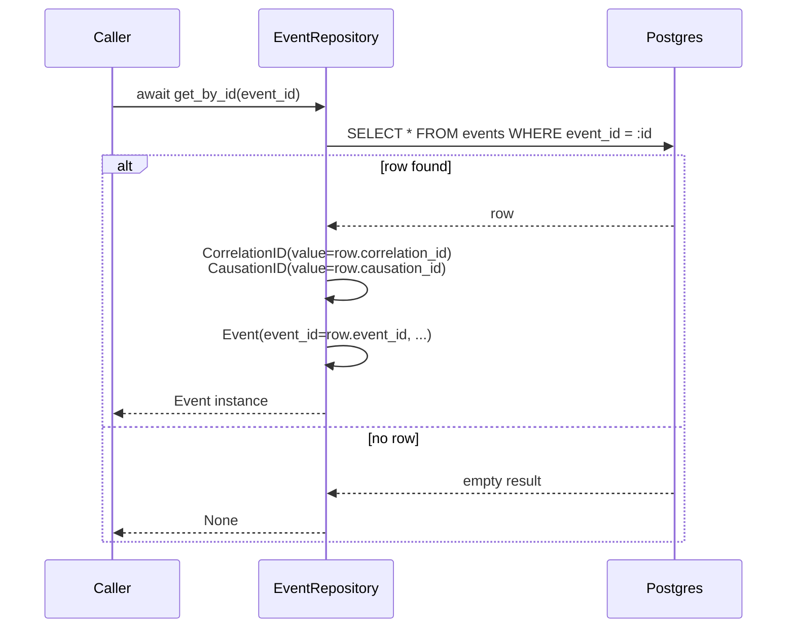
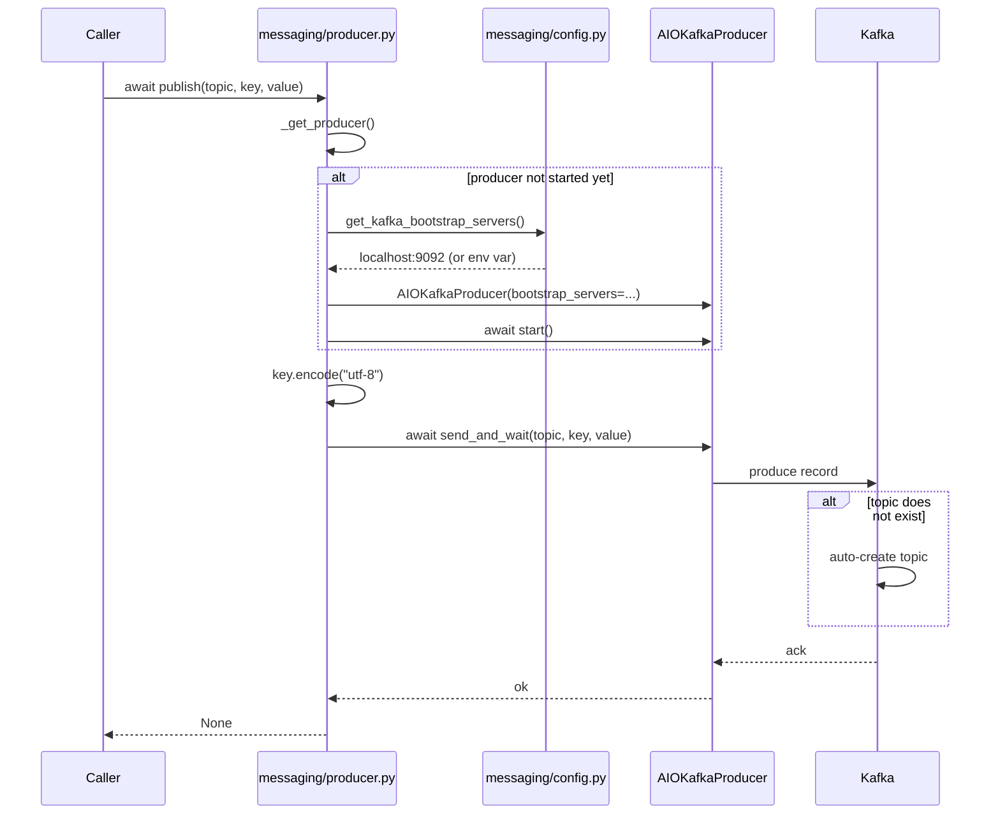
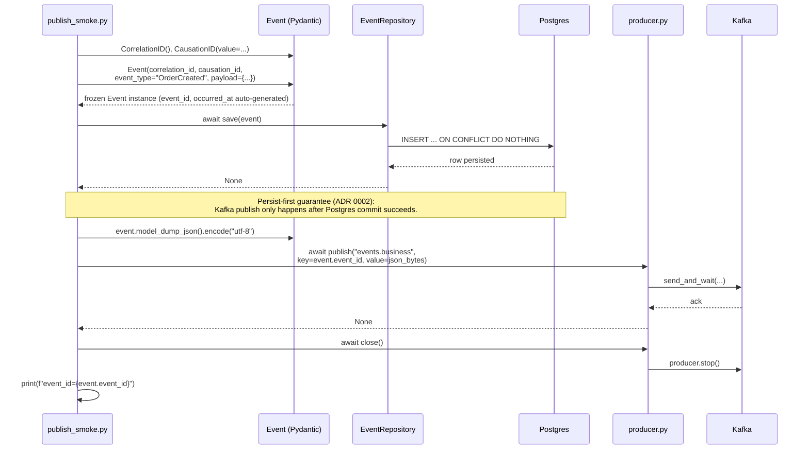
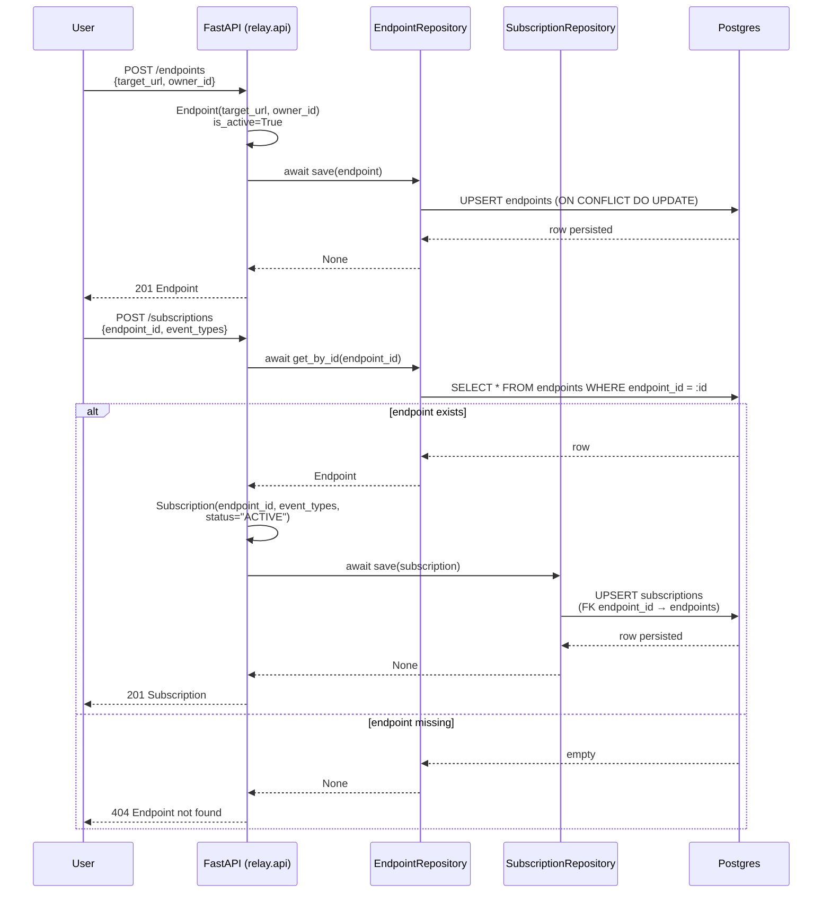

# Data Plane — Sequence Diagrams

Runtime behavior for Week 1 Steps 2–6, Week 2 registration routes, and
Week 3–4 dispatch / delivery / retry, reflecting the actual implementation
(not the plan). See `docs/Diagrams/data-plane-class-diagram.md` for the
static structure these sequences operate on.

---

## 1. Docker Compose stack startup (Step 2)



---

## 2. Alembic migration — create `events` table (Step 3)



---

## 3. `EventRepository.save()` (Step 4)



---

## 4. `EventRepository.get_by_id()` (Step 4)



---

## 5. Kafka `publish()` (Step 5)



---

## 6. Full Week 1 smoke script — `Event → Postgres → Kafka` (Step 6)

This is the Week 1 stop line: the composition of diagrams 3 and 5, driven
by `scripts/publish_smoke.py`.



**Verified live** (see commit `4bb5cee`): the row in Postgres and the message
on `events.business` were independently confirmed to contain matching data
for the same `event_id`.

---

## 7. Register Endpoint then Subscription (Week 2)

`POST /endpoints` then `POST /subscriptions`. Kafka is not on this path —
these are configuration writes only. The subscription route looks up the
endpoint before insert so a missing `endpoint_id` returns 404 instead of a
raw FK error.



---

## 8. Dispatcher — `events.business` fan-out (Week 3)

`KafkaConsumer` yields a message. Dispatcher parses `Event`, loads ACTIVE
subscriptions for `event_type`, then per subscription persist-first
`Delivery` + initial `DeliveryAttempt`, then `StrategyA.evaluate()`. HTTP
runs only if isolation is not `PAUSE` / `QUARANTINE`. Offset is committed
after Postgres, not after HTTP.

```mermaid
sequenceDiagram
    participant Kafka
    participant Consumer as KafkaConsumer
    participant Disp as Dispatcher
    participant SubRepo as SubscriptionRepository
    participant DelRepo as DeliveryRepository
    participant AttRepo as DeliveryAttemptRepository
    participant Strat as StrategyA
    participant EPRepo as EndpointRepository
    participant Worker as WebhookWorker
    participant PG as Postgres

    Kafka->>Consumer: events.business (event.model_dump_json)
    Consumer->>Disp: KafkaMessage
    Disp->>Disp: Event.model_validate_json(message.value)
    Disp->>SubRepo: list_active_by_event_type(event.event_type)
    SubRepo->>PG: SELECT ... status=ACTIVE AND event_types contains type
    PG-->>SubRepo: rows
    SubRepo-->>Disp: list~Subscription~

    loop per ACTIVE Subscription
        Disp->>Disp: Delivery(event_id, subscription_id,<br/>endpoint_id, status=PENDING)
        Disp->>DelRepo: await save(delivery)
        DelRepo->>PG: INSERT deliveries<br/>(unique event_id + subscription_id)
        PG-->>DelRepo: row persisted
        Disp->>AttRepo: await save(DeliveryAttempt attempt_number=1)
        AttRepo->>PG: INSERT delivery_attempts
        PG-->>AttRepo: row persisted

        Note over Disp,PG: Persist-first (ADR 0002):<br/>HTTP is not required before the Kafka offset commit.

        Disp->>Strat: evaluate(endpoint_id,<br/>AVAILABLE, eri, computed_at)
        Strat-->>Disp: DeliveryPolicy<br/>(EXPONENTIAL 5s ×2 cap 300s max 10)
        alt isolation PAUSE / QUARANTINE
            Disp->>Disp: skip HTTP; Delivery stays durable
        else CONTINUE
            Disp->>EPRepo: get_by_id(delivery.endpoint_id)
            EPRepo-->>Disp: Endpoint (target_url)
            Disp->>Worker: execute(attempt, target_url,<br/>endpoint_id, delivery, policy)
        end
    end

    Disp->>Consumer: commit(message)
```

---

## 9. Webhook Worker then Retry Manager (Week 4)

Worker POSTs once to Simulator `POST /webhook` (no backoff). On 5xx it
persists the completed `DeliveryAttempt` and a `Telemetry` row, then
Retry Manager applies `retry_policy` fields and publishes the next
attempt to `events.internal.delivery`. Dispatcher later consumes that
topic, waits until `next_attempt_at`, and calls the worker again.

```mermaid
sequenceDiagram
    participant Disp as Dispatcher
    participant Worker as WebhookWorker
    participant Sim as Simulator POST /webhook
    participant AttRepo as DeliveryAttemptRepository
    participant TelRepo as TelemetryRepository
    participant Retry as RetryManager
    participant DelRepo as DeliveryRepository
    participant Wrapper as producer.py
    participant Consumer as KafkaConsumer
    participant Kafka
    participant PG as Postgres

    Disp->>Worker: execute(attempt, target_url, endpoint_id,<br/>delivery, policy)
    Worker->>Sim: HTTP POST (httpx, strict timeout)
    Sim-->>Worker: 5xx
    Worker->>Worker: attempt.model_copy<br/>(completed_at, http_status, success=False)
    Worker->>AttRepo: await save(completed)
    AttRepo->>PG: complete outcome columns<br/>(completed_at was null)
    PG-->>AttRepo: row updated
    Worker->>TelRepo: await save(Telemetry)
    TelRepo->>PG: INSERT telemetry<br/>ON CONFLICT (attempt_id) DO NOTHING
    PG-->>TelRepo: observation persisted
    Worker->>Retry: handle(completed, delivery, policy)

    alt success
        Retry->>DelRepo: save(status=SUCCESS)
        DelRepo->>PG: UPSERT deliveries.status
    else attempt_number greater or equal max_retries
        Retry->>DelRepo: save(status=FAILED)
        DelRepo->>PG: UPSERT deliveries.status
    else isolation PAUSE / QUARANTINE
        Retry->>Retry: no HTTP; Delivery stays PENDING
    else retry
        Retry->>Retry: delay = min(5 * 2^(n-1), 300)
        Retry->>AttRepo: save(DeliveryAttempt n+1)
        AttRepo->>PG: INSERT delivery_attempts
        Retry->>Wrapper: publish("events.internal.delivery",<br/>key=event_id, RetryWork JSON)
        Wrapper->>Kafka: send_and_wait
        Kafka-->>Wrapper: ack
    end

    Kafka->>Consumer: events.internal.delivery (RetryWork)
    Consumer->>Disp: KafkaMessage
    Disp->>Consumer: commit(message)
    Disp->>Disp: sleep until next_attempt_at
    Disp->>Worker: execute(next attempt, target_url, ...)
```
