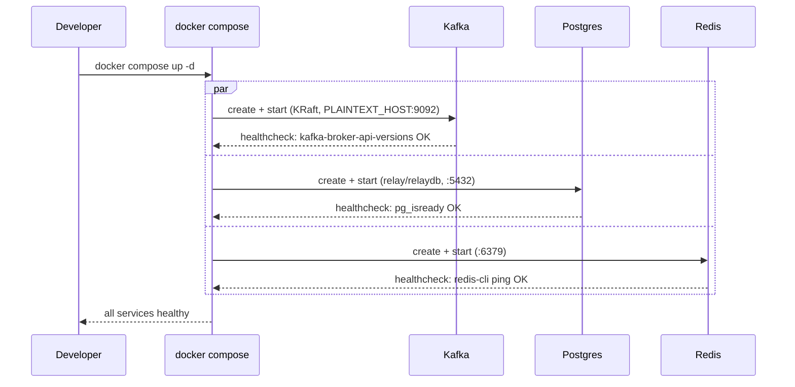
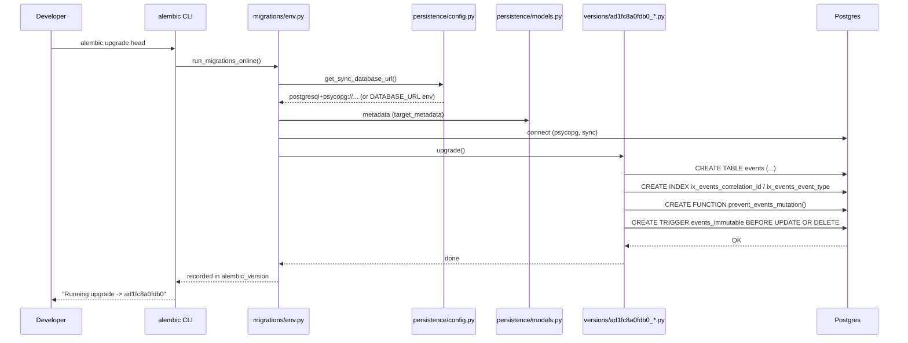
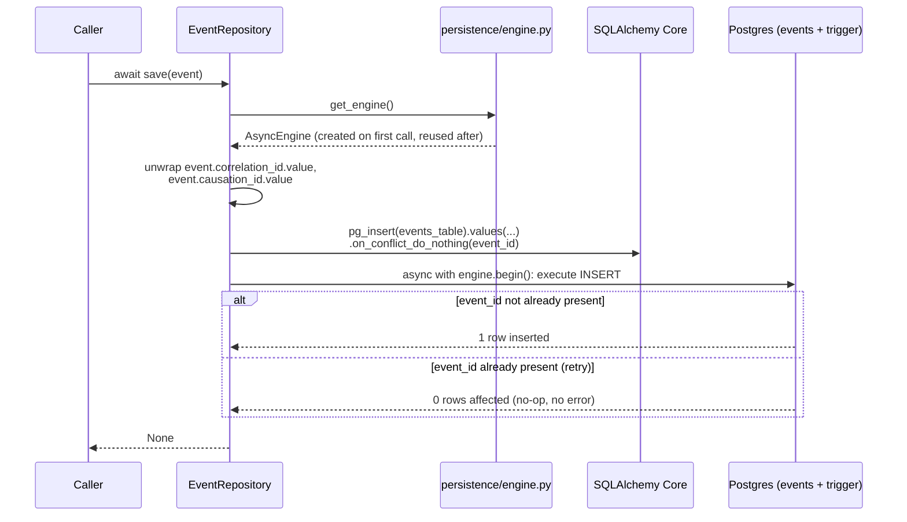
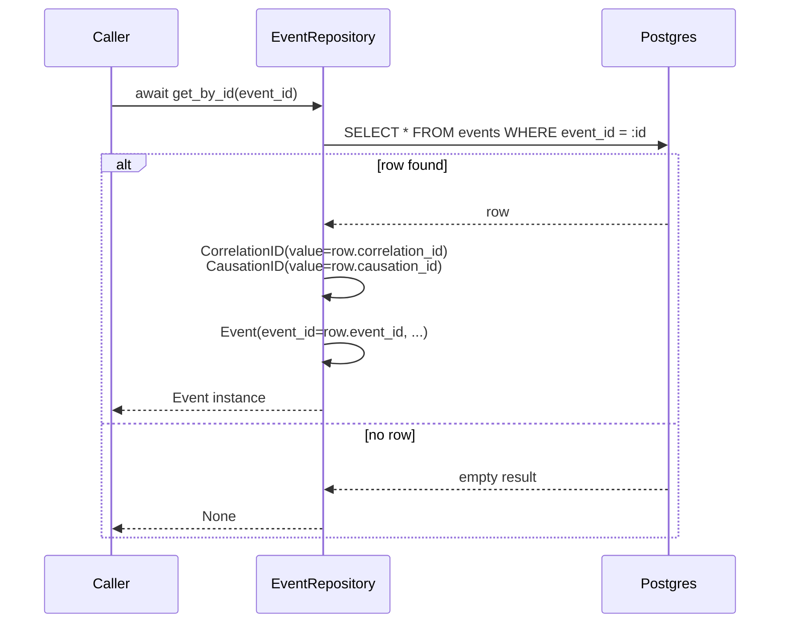
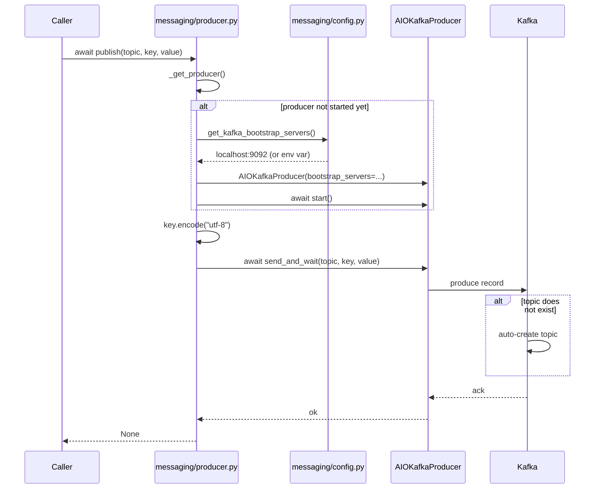
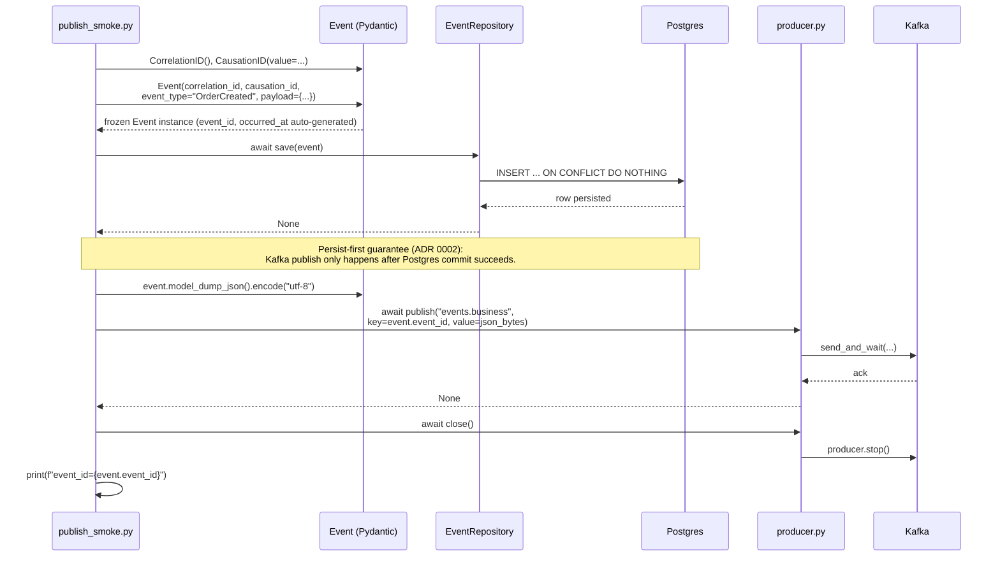
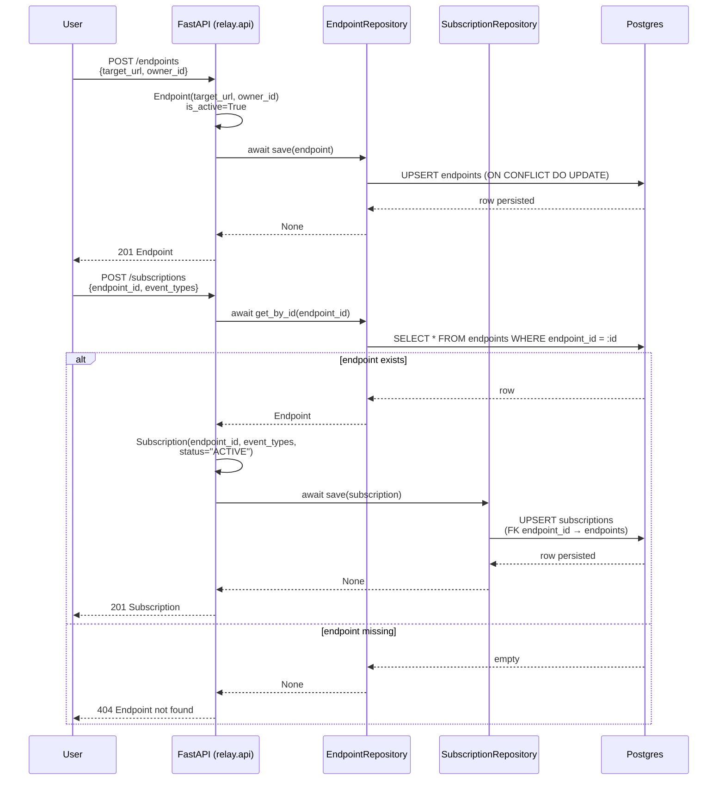

# Data Plane — Sequence Diagrams

Runtime behavior for Week 1 Steps 2–6 and Week 2 registration routes,
reflecting the actual implementation (not the plan). See
`docs/data-plane-class-diagram.md` for the static structure these sequences
operate on.

---

## 1. Docker Compose stack startup (Step 2)

---

## 2. Alembic migration — create `events` table (Step 3)

---

## 3. `EventRepository.save()` (Step 4)

---

## 4. `EventRepository.get_by_id()` (Step 4)

---

## 5. Kafka `publish()` (Step 5)

---

## 6. Full Week 1 smoke script — `Event → Postgres → Kafka` (Step 6)

This is the Week 1 stop line: the composition of diagrams 3 and 5, driven
by `scripts/publish_smoke.py`.

**Verified live** (see commit `4bb5cee`): the row in Postgres and the message
on `events.business` were independently confirmed to contain matching data
for the same `event_id`.

---

## 7. Register Endpoint then Subscription (Week 2)

`POST /endpoints` then `POST /subscriptions`. Kafka is not on this path —
these are configuration writes only. The subscription route looks up the
endpoint before insert so a missing `endpoint_id` returns 404 instead of a
raw FK error.

