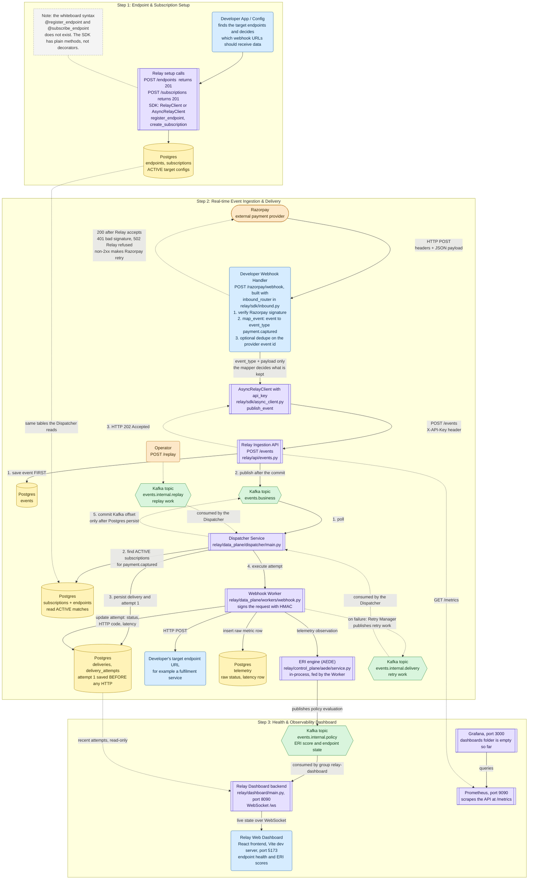

# Integration overview

This page follows one real-world example, a **Razorpay `payment.captured` webhook**, through RelayForge from end to end. It turns the whiteboard sketch ("High Level Overview") into the actual modules, tables and Kafka topics in this repository.

Read it top to bottom: **Step 1** sets up where events should go, **Step 2** is the live delivery path, and **Step 3** is how you watch endpoint health.



## Reading the diagram

- **Colours:** orange is an external actor, blue is developer code, purple is a Relay service, green hexagons are Kafka topics and yellow cylinders are Postgres tables.
- **Solid arrows** are the main path. **Dotted arrows** are replies, retries, replays and read-only side paths.
- **Persist-first:** Relay never publishes to Kafka before the event row is committed in Postgres. The Dispatcher never commits a Kafka offset before its Postgres writes succeed. A delivery and its first attempt are saved before any HTTP call is made.
- **If Kafka publish fails** after the event is saved, the API returns `503` and the event is not treated as accepted (`relay/api/events.py`).

## Where the code differs from the whiteboard

| Whiteboard | What the code does |
| :--- | :--- |
| `@register_endpoint(url)` and `@subscribe_endpoint(id, [event_types])` | These decorators do not exist. Use `RelayClient.register_endpoint(target_url, owner_id)` and `RelayClient.create_subscription(endpoint_id, event_types)`, or call `POST /endpoints` and `POST /subscriptions` directly. |
| "Worker" as a separate step | The Worker is a class called by the Dispatcher inside the same process (`relay/data_plane/dispatcher/main.py` calls `relay/data_plane/workers/webhook.py`). There is no separate worker service in `docker-compose.yml`. |
| Telemetry in Postgres is read by the ERI engine | The Worker saves the `telemetry` row, then passes the same observation straight to the in-process ERI engine. Nothing reads the `telemetry` table back at runtime. |
| Dashboard reads telemetry from Postgres | The dashboard gets ERI score and endpoint state from the `events.internal.policy` topic, and the recent delivery timeline from `delivery_attempts`. |
| SDK `publish` with an API key | `RelayClient(api_key=...)` and `AsyncRelayClient(api_key=...)` send it as `X-API-Key`. Without a key they work only while the API runs unauthenticated (`RELAY_ENV=dev` and no `RELAY_API_KEYS`, which is how `docker-compose.yml` runs it). |
| Any target URL | Webhook targets are checked by the SSRF guard (`relay/infrastructure/url_guard.py`). `localhost` and private addresses are rejected unless `RELAY_ALLOW_PRIVATE_TARGETS=true`, which `docker-compose.yml` sets for local demos only. |

## Example: the Razorpay webhook handler written by hand

The "Developer Webhook Handler" box from Step 2 is built with `inbound_router`, shown in the next section. This longer version does the same steps by hand with plain `httpx`, so you can see what the boilerplate does for you. It checks Razorpay's signature, builds the event Relay expects (`event_type` and `payload`, see `IngestEventRequest` in `relay/api/schemas.py`) and posts it to `POST /events`. Relay answers `202` with `{"event_id": ...}`.

```python
import hashlib
import hmac
import json
import os

import httpx
from fastapi import FastAPI, HTTPException, Request

RELAY_URL = os.environ.get("RELAY_URL", "http://localhost:8000")
RELAY_API_KEY = os.environ.get("RELAY_API_KEY")  # sent as X-API-Key when set
RAZORPAY_WEBHOOK_SECRET = os.environ["RAZORPAY_WEBHOOK_SECRET"]

app = FastAPI()
relay = httpx.AsyncClient(base_url=RELAY_URL, timeout=10.0)


def razorpay_signature_is_valid(raw_body: bytes, signature: str) -> bool:
    # Razorpay signs the raw request body with HMAC-SHA256 (hex digest).
    expected = hmac.new(
        RAZORPAY_WEBHOOK_SECRET.encode("utf-8"), raw_body, hashlib.sha256
    ).hexdigest()
    return hmac.compare_digest(expected, signature)


@app.post("/razorpay/webhook")
async def razorpay_webhook(request: Request):
    raw_body = await request.body()
    signature = request.headers.get("X-Razorpay-Signature", "")
    if not razorpay_signature_is_valid(raw_body, signature):
        raise HTTPException(status_code=401, detail="Invalid Razorpay signature")

    body = json.loads(raw_body)
    payment = body["payload"]["payment"]["entity"]

    headers = {"X-API-Key": RELAY_API_KEY} if RELAY_API_KEY else {}
    response = await relay.post(
        "/events",
        headers=headers,
        json={
            "event_type": body["event"],  # for example "payment.captured"
            "payload": {
                "payment_id": payment["id"],
                "amount": payment["amount"],
                "currency": payment["currency"],
                "order_id": payment.get("order_id"),
            },
        },
    )

    # Relay returns 202 only after the event is saved and published. Any
    # other status (for example 503 if Kafka publish failed) is passed on
    # as an error so Razorpay retries the webhook.
    if response.status_code != 202:
        raise HTTPException(status_code=502, detail="Relay did not accept the event")

    return {"ok": True, "event_id": response.json()["event_id"]}
```

### The same handler with the SDK boilerplate

`relay/sdk/inbound.py` does the fixed steps for you (size limit, signature check, JSON parse, publish, status codes). You write only `verify` and `map_event`:

```python
import os

from fastapi import FastAPI

from relay.sdk import AsyncRelayClient, hmac_sha256_hex, inbound_router

app = FastAPI()
relay = AsyncRelayClient(
    base_url=os.environ.get("RELAY_URL", "http://localhost:8000"),
    api_key=os.environ.get("RELAY_API_KEY"),
)


def map_razorpay(body, headers):
    if body["event"] != "payment.captured":
        return None  # not wanted: answer 200, publish nothing
    entity = body["payload"]["payment"]["entity"]
    return body["event"], {
        "payment_id": entity["id"],
        "amount": entity["amount"],
        "currency": entity["currency"],
        "order_id": entity.get("order_id"),
    }


app.include_router(
    inbound_router(
        path="/razorpay/webhook",
        verify=hmac_sha256_hex(os.environ["RAZORPAY_WEBHOOK_SECRET"], "X-Razorpay-Signature"),
        map_event=map_razorpay,
        relay=relay,
        dedupe_key=lambda body, headers: headers.get("x-razorpay-event-id"),
    )
)
```

Status codes returned to the provider:

| Situation | Status | Provider retries? |
| :--- | :--- | :--- |
| Body larger than 1 MiB | `413` | yes |
| Signature missing or wrong | `401` | yes |
| Body is not a JSON object | `400` | yes |
| `map_event` raised or returned a bad shape | `422` | yes |
| `map_event` returned `None` (event not wanted) | `200` | no |
| Same provider event id already forwarded | `200` | no |
| Relay did not answer `202` (down, Kafka failure, bad API key) | `502` | yes |
| Relay accepted the event | `200` | no |

Notes:

- `hmac_sha256_hex` covers the "HMAC-SHA256 of the raw body, hex" scheme (Razorpay). Pass `prefix="sha256="` for GitHub-style headers. Schemes that also sign a timestamp, such as Stripe, need your own `verify(raw_body, headers) -> bool`.
- The built-in dedupe store is in memory and per process. Use your own `DedupeStore` (for example on Redis) behind several replicas. An id is remembered only after Relay accepts the event, so a failed publish is retried, not dropped.
- `handle_inbound(...)` is the same logic without FastAPI, for other frameworks.

To register the target that will receive the event, call the SDK once during setup:

- `RelayClient().register_endpoint(target_url, owner_id)` returns an `endpoint_id`.
- `RelayClient().create_subscription(endpoint_id, ["payment.captured"])` activates the subscription.

## What the subscriber receives (the outbound webhook)

The outbound webhook is the inbound data repackaged. The only link between the two sides is the `event_type` string.

1. Your handler sends `event_type` and `payload` to `POST /events`. Relay never sees Razorpay's original body or headers.
2. `build_event()` in `relay/api/events.py` keeps both fields unchanged and adds `event_id`, `correlation_id`, `causation_id` and `occurred_at`.
3. The Dispatcher matches the Event's `event_type` against `ACTIVE` subscriptions. One inbound event produces one outbound webhook per matching subscription.
4. `_build_request()` in `relay/data_plane/workers/webhook.py` sends the whole Event (`event.model_dump_json()`) as the body. Delivery details go in headers.

```
POST <endpoint target_url>
Content-Type:            application/json
User-Agent:              RelayForge/0.1
X-Relay-Event-Id:        <event_id>
X-Relay-Event-Type:      payment.captured
X-Relay-Delivery-Id:     <delivery_id>
X-Relay-Attempt-Id:      <attempt_id>
X-Relay-Attempt-Number:  1
X-Relay-Timestamp, X-Relay-Signature, X-Relay-Nonce   (only when the policy requires HMAC)

{
  "event_id": "...",
  "correlation_id": { ... },
  "causation_id": { ... },
  "event_type": "payment.captured",
  "payload": {
    "payment_id": "...",
    "amount": ...,
    "currency": "...",
    "order_id": "..."
  },
  "occurred_at": "..."
}
```

Your original fields sit under `payload`, so a subscriber reads `body["payload"]["payment_id"]`, not `body["payment_id"]`.

What to plan for:

- **You decide what is kept.** Anything your handler leaves out of `payload` is lost to every subscriber. Relay stores no raw Razorpay body.
- **Delivery is at least once.** Retries and replays resend the same stored Event with the same `event_id`. Subscribers should deduplicate on `X-Relay-Event-Id`.
- **Two separate signatures.** Razorpay signs its request with `X-Razorpay-Signature`, which your handler verifies. Relay signs its own outbound request with `X-Relay-Signature` using `RELAY_WEBHOOK_SIGNING_SECRET`. They use different secrets.
- **The event type must match.** A subscription only receives events whose `event_type` equals one of its `event_types`. If the handler sends `payment.captured`, the subscription must list `payment.captured`.
- **Step 1 holds no data.** `endpoints` and `subscriptions` only record where to send and which event types each endpoint wants. The data comes from the live event in Step 2.

## Component mapping

| Diagram Component | Real Module / File Path | Database Table / Kafka Topic |
| :--- | :--- | :--- |
| Developer App / Config (Step 1) | Your own code. SDK clients: `relay/sdk/client.py` (`RelayClient`) and `relay/sdk/async_client.py` (`AsyncRelayClient`) | n/a |
| Register endpoint (`POST /endpoints`) | `relay/api/endpoints.py`, `relay/infrastructure/persistence/endpoint_repository.py` | `endpoints` (Table) |
| Create subscription (`POST /subscriptions`) | `relay/api/subscriptions.py`, `relay/infrastructure/persistence/subscription_repository.py` | `subscriptions` (Table) |
| Target URL safety check | `relay/infrastructure/url_guard.py` | n/a |
| Razorpay | External service | n/a |
| Developer Webhook Handler | Your own app. The fixed steps come from `relay/sdk/inbound.py` (`inbound_router`, `handle_inbound`, `hmac_sha256_hex`, `InMemoryDedupe`). You write only `verify` and `map_event` | n/a |
| SDK publish client | `relay/sdk/async_client.py` (`AsyncRelayClient.publish_event`, sends `X-API-Key`), shared response handling in `relay/sdk/_http.py` | n/a |
| Ingestion API | `relay/api/events.py` (`ingest_event`, `persist_and_publish`) | `events` (Table), `events.business` (Topic) |
| API authentication | `relay/api/security.py` (`X-API-Key`, `RELAY_API_KEYS`) | n/a |
| Event persistence | `relay/infrastructure/persistence/event_repository.py` | `events` (Table) |
| Kafka producer | `relay/infrastructure/messaging/producer.py` | `events.business` (Topic) |
| Dispatcher Service | `relay/data_plane/dispatcher/main.py` (`Dispatcher`) | Reads `events.business`, `events.internal.delivery`, `events.internal.replay`. Consumer group `relay-dispatcher` |
| Active subscription lookup | `relay/infrastructure/persistence/subscription_repository.py` (`list_active_targets_by_event_type`) | `subscriptions`, `endpoints` (Tables) |
| Delivery and attempt persistence | `relay/infrastructure/persistence/delivery_repository.py`, `relay/infrastructure/persistence/delivery_attempt_repository.py` | `deliveries`, `delivery_attempts` (Tables) |
| Webhook Worker | `relay/data_plane/workers/webhook.py` (HMAC signing via `relay/infrastructure/auth/signing.py`) | `delivery_attempts` (Table, outcome update) |
| HTTP transport to the target | `relay/adapters/webhook/adapter.py` (`WebhookDeliveryAdapter`) | n/a |
| Telemetry row | `relay/infrastructure/persistence/telemetry_repository.py` | `telemetry` (Table) |
| ERI engine (AEDE) | `relay/control_plane/aede/service.py`, `relay/control_plane/eri/` | `events.internal.policy` (Topic, published) |
| Retry Manager | `relay/data_plane/retry_manager/manager.py` | `events.internal.delivery` (Topic) |
| Replay (`POST /replay`) | `relay/api/endpoints.py`, `relay/data_plane/replay/manager.py` | `events.internal.replay` (Topic) |
| Dashboard backend | `relay/dashboard/main.py`, `relay/dashboard/websocket.py`, `relay/dashboard/adapter.py` | Reads `events.internal.policy` (group `relay-dashboard`) and `delivery_attempts` (Table) |
| Relay Web Dashboard (UI) | `relay/dashboard/frontend/` (React, Vite) | n/a |
| Prometheus | `deploy/prometheus.yml` (targets `api:8000` and `dispatcher:9100`), service `prometheus` in `docker-compose.yml` | n/a |
| Prometheus metrics definitions | `relay/infrastructure/monitoring/metrics.py`, API `/metrics` in `relay/api/main.py` | n/a |
| Grafana | `deploy/grafana/`, service `grafana` in `docker-compose.yml` | n/a |

## Notes

- **Topic names:** the flow also uses `events.internal.policy`, which exists in `relay/infrastructure/messaging/admin.py`. The dashboard depends on it for ERI scores.
- **Prometheus and Grafana** are in `docker-compose.yml`. Today Prometheus scrapes the API's HTTP metrics. It is also configured to scrape the Dispatcher on port 9100, but nothing in the Dispatcher starts that metrics server yet, so that target shows as down. The delivery and ERI metrics are defined in `relay/infrastructure/monitoring/metrics.py` but the data plane does not emit them yet, and Grafana has no dashboards.
- **Auth:** with `RELAY_ENV` set to anything other than `dev`, every route needs a valid `X-API-Key` (`relay/api/security.py`).
