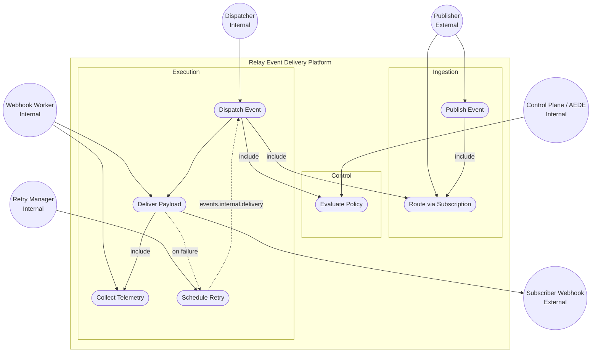

# Data Plane — Use Cases (Weeks 1–4)

Actors and boundaries for ingestion, policy, and execution. Week 3–4 Control Plane is `StrategyA` (static EXPONENTIAL policy). Live AEDE is out of sprint scope but remains the named Control actor (ADR 0003, 0005).

## Actors

| Actor | Kind | Role |
|---|---|---|
| **Publisher** | External | `POST /events`. Persist-first then `events.business`. |
| **Subscriber Webhook** | External | Simulator `POST /webhook`. Receives the HTTP attempt. |
| **Control Plane / AEDE** | Internal | Produces `DeliveryPolicy`. Weeks 1–4: `StrategyA.evaluate()`. |
| **Dispatcher** | Internal | Consume Kafka, fan-out, persist Delivery/Attempt, evaluate, hand off. |
| **Webhook Worker** | Internal | One HTTP POST. Persist completed attempt + Telemetry. No backoff. |
| **Retry Manager** | Internal | Apply `retry_policy` fields. Publish `RetryWork` to `events.internal.delivery`. |

## Use cases

| Use case | Boundary | What happens |
|---|---|---|
| **Publish Event** | Ingestion | Validate → Postgres `events` → Kafka `events.business` → 202. |
| **Route via Subscription** | Ingestion | ACTIVE subscriptions whose `event_types` contain `event_type`. |
| **Dispatch Event** | Execution | Persist `Delivery` (+ attempt 1 if HTTP will run). Commit offset after Postgres. |
| **Evaluate Policy** | Control | `StrategyA` → EXPONENTIAL 5s / ×2 / cap 300s / max 10. Honor `PAUSE` / `QUARANTINE`. |
| **Deliver Payload** | Execution | `httpx` POST to `target_url`. Observe 5xx / timeout / slow / 429. |
| **Collect Telemetry** | Execution | One `Telemetry` row per `attempt_id` (ERI input). |
| **Schedule Retry** | Execution | New attempt row; delay on `RetryWork.next_attempt_at`; publish `events.internal.delivery`. |
