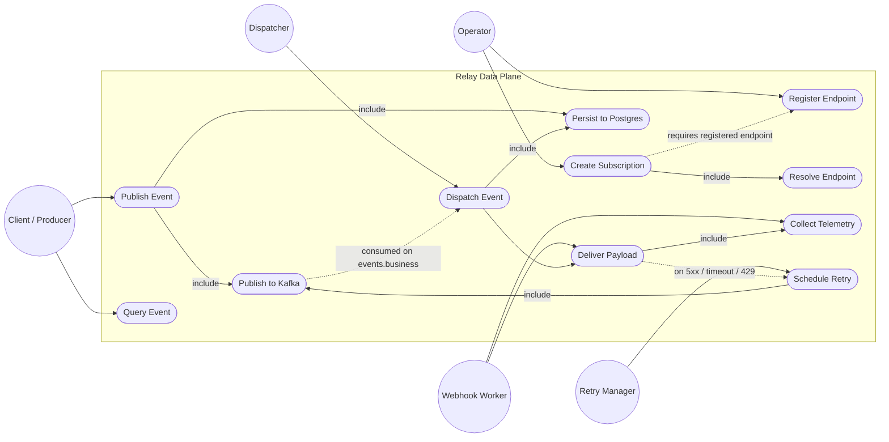

# Data Plane — Use Case Diagram (Weeks 1–4)

Actors and use cases for the ingestion pipeline (Weeks 1–2) plus dispatch,
webhook delivery, telemetry, and retry scheduling (Weeks 3–4).
AEDE live path is out of scope — Week 3–4 uses `StrategyA` only.
Surface: `relay/api/`, persistence, Kafka wrappers, `relay/data_plane/`.

Mermaid has no UML use-case shape, so actors are circles and use cases sit
inside the system boundary as stadium nodes (`([ ... ])`).



## Actors

**Client / Producer** — an application (or the Week 1/2 smoke scripts acting as one) that publishes business events and later looks them up by id.

**Operator** — a person or setup script that registers webhook destinations and binds event types to those destinations before traffic flows.

**Dispatcher** — Data Plane consumer process. Reads `events.business` and `events.internal.delivery`, fans out to ACTIVE subscriptions, persists `Delivery` + initial `DeliveryAttempt`, calls `StrategyA.evaluate()`, then hands work to the webhook worker.

**Webhook Worker** — stateless HTTP executor. POSTs once to `endpoint.target_url` (Simulator `POST /webhook`), then persists the completed attempt and `Telemetry`. Does not compute backoff or select a strategy.

**Retry Manager** — schedules the next `DeliveryAttempt` from `DeliveryPolicy.retry_policy` fields (EXPONENTIAL: 5s, ×2, cap 300s, max 10) and publishes `RetryWork` to `events.internal.delivery`. Does not sleep.

## Use cases


| Use case                | How it is invoked                                     | What the system does                                                                                                                                     |
| ----------------------- | ----------------------------------------------------- | -------------------------------------------------------------------------------------------------------------------------------------------------------- |
| **Publish Event**       | `POST /events` (`event_type` + `payload`)             | Build a frozen `Event` with `CorrelationID` / `CausationID`, **persist first**, then publish to `events.business`. Returns **202** only if both succeed. |
| **Query Event**         | `GET /events/{id}`                                    | Load the event from Postgres. **200** or **404**.                                                                                                        |
| **Register Endpoint**   | `POST /endpoints` (`target_url` + `owner_id`)         | Upsert an `Endpoint` (`is_active=True`). **201**.                                                                                                        |
| **Create Subscription** | `POST /subscriptions` (`endpoint_id` + `event_types`) | Confirm the endpoint exists (**404** if not), then upsert a `Subscription` (`status=ACTIVE`). **201**.                                                   |
| **Dispatch Event**      | `KafkaConsumer` on `events.business`                  | Parse `Event`, `list_active_by_event_type`, persist `Delivery` + attempt 1, `StrategyA.evaluate()`, enqueue worker. Commit offset after Postgres.        |
| **Deliver Payload**     | `WebhookWorker.execute()`                             | HTTP POST to Simulator. Map 5xx / timeout / slow / 429. Persist completed `DeliveryAttempt` via `model_copy`. No backoff in the worker.                  |
| **Collect Telemetry**   | after each HTTP attempt                               | Persist frozen `Telemetry` (`attempt_id`, `endpoint_id`, `latency_ms`, `timed_out`, `succeeded`). One observation per attempt.                            |
| **Schedule Retry**      | `RetryManager.handle()` on failure                    | If `attempt_number < max_retries` and isolation is not PAUSE/QUARANTINE: new attempt row, delay from policy fields, publish `events.internal.delivery`.  |


**Include** links: Publish Event always runs Persist then Kafka (ADR 0002 persist-first; ADR 0005 — no retry in the HTTP route). Create Subscription always resolves `endpoint_id` before insert (FK to `endpoints`). Dispatch Event always persists `Delivery` + attempt before HTTP. Deliver Payload always Collects Telemetry. Schedule Retry always publishes to Kafka (`events.internal.delivery`).

**Requires** (dashed): a subscription is only useful after an endpoint is registered. The API enforces that with the lookup + FK, not with Kafka. Dispatch consumes Publish's Kafka record. Schedule Retry runs when Deliver Payload observes a non-success (5xx, timeout, 429).

Week 1 `scripts/publish_smoke.py` is the same **Publish Event** use case without HTTP — it calls `EventRepository` and `publish()` directly. Week 2 `scripts/api_smoke.sh` is **Publish Event** + **Query Event** over HTTP.

```mermaid
graph TD
    Client([Client / Producer])
    Dispatcher([Dispatcher])
    Worker([Webhook Worker])
    RetryMgr([Retry Manager])
    Simulator([Simulator])

    subgraph "FastAPI App (relay/api)"
        RouteEvents[Events Router]
        RouteEndpoints[Endpoints Router]
        RouteSubs[Subscriptions Router]
    end

    subgraph "PostgreSQL (relay/infrastructure/persistence)"
        DBEvents[(events_table)]
        DBEndpoints[(endpoints_table)]
        DBSubs[(subscriptions_table)]
        DBDeliveries[(deliveries_table)]
        DBAttempts[(delivery_attempts_table)]
        DBTelemetry[(telemetry_table)]
    end

    subgraph "Kafka (relay/infrastructure/messaging)"
        KafkaTopic[[events.business Topic]]
        KafkaRetry[[events.internal.delivery Topic]]
    end

    subgraph "Data Plane (relay/data_plane)"
        DispNode[Dispatcher]
        WorkerNode[Webhook Worker]
        RetryNode[Retry Manager]
        StratA[StrategyA]
    end

    %% Event Ingestion & Query
    Client -->|1. POST /events| RouteEvents
    Client -->|4. GET /events/{id}| RouteEvents
    
    RouteEvents -->|2. EventRepository.save| DBEvents
    RouteEvents -->|3. KafkaProducer.publish| KafkaTopic
    RouteEvents -.->|5. EventRepository.get_by_id| DBEvents

    %% Endpoints Setup
    Client -->|6. POST /endpoints| RouteEndpoints
    RouteEndpoints -->|7. EndpointRepository.save| DBEndpoints

    %% Subscriptions Setup
    Client -->|8. POST /subscriptions| RouteSubs
    RouteSubs -.->|9. Verify Endpoint Exists| DBEndpoints
    RouteSubs -->|10. SubscriptionRepository.save| DBSubs

    %% Dispatch & delivery
    KafkaTopic -->|11. KafkaConsumer| DispNode
    DispNode -->|12. list_active_by_event_type| DBSubs
    DispNode -->|13. DeliveryRepository.save| DBDeliveries
    DispNode -->|14. DeliveryAttemptRepository.save| DBAttempts
    DispNode -->|15. evaluate| StratA
    DispNode -->|16. execute| WorkerNode
    WorkerNode -->|17. HTTP POST /webhook| Simulator
    WorkerNode -->|18. complete attempt| DBAttempts
    WorkerNode -->|19. TelemetryRepository.save| DBTelemetry
    WorkerNode -->|20. handle| RetryNode
    RetryNode -->|21. next attempt + publish| KafkaRetry
    KafkaRetry -->|22. KafkaConsumer| DispNode

    Dispatcher --- DispNode
    Worker --- WorkerNode
    RetryMgr --- RetryNode

    classDef db fill:#f9f0ff,stroke:#333,stroke-width:2px;
    classDef api fill:#e1f5fe,stroke:#333,stroke-width:2px;
    classDef client fill:#fff3e0,stroke:#333,stroke-width:2px;
    
    class DBEvents,DBEndpoints,DBSubs,DBDeliveries,DBAttempts,DBTelemetry db;
    class RouteEvents,RouteEndpoints,RouteSubs,DispNode,WorkerNode,RetryNode,StratA api;
    class Client,Dispatcher,Worker,RetryMgr,Simulator client;
```
