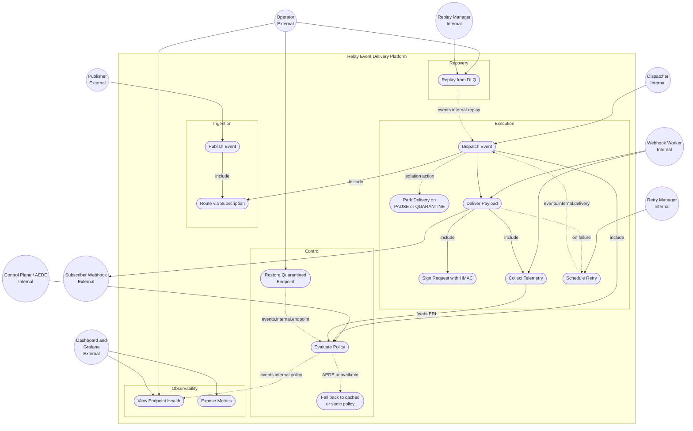

# Relay — Use Cases

Actors and boundaries for ingestion, control, execution, recovery and observability, as the code on `dev` implements them. The Control Plane is live: AEDE turns telemetry into ERI, endpoint state and a `DeliveryPolicy` (ADR 0003, 0005). The static Strategy A policy is the last-resort fallback, not the only policy.

## Actors

| Actor | Kind | Role |
|---|---|---|
| **Publisher** | External | `POST /events`. Persist-first (Postgres), then `events.business`. |
| **Operator** | External | `POST /endpoints/{id}/restore`, `POST /replay`, and reads the dashboard. Authenticated with `X-API-Key` outside dev (ADR 0018). |
| **Subscriber Webhook** | External | The receiver of the HTTP POST. In the demo it is the simulator's `POST /webhook`. |
| **Dashboard and Grafana** | External | The React dashboard reads the dashboard backend (`/ws`, `/api/chart/*`). Prometheus scrapes the API and the dispatcher; Grafana reads Prometheus. |
| **Control Plane / AEDE** | Internal | `AEDEService`: telemetry in, ERI, endpoint state and `DeliveryPolicy` out; publishes each evaluation to `events.internal.policy`. |
| **Dispatcher** | Internal | Consumes four topics, fans out, persists Delivery and attempt before any HTTP, picks the policy, commits offsets after Postgres. |
| **Webhook Worker** | Internal | One HTTP POST through a `DeliveryAdapter`. Persists the completed attempt and a `Telemetry` row. No backoff, no strategy choice. |
| **Retry Manager** | Internal | Applies `retry_policy` fields. Publishes `RetryWork` to `events.internal.delivery`. |
| **Replay Manager** | Internal | API side. Selects dead-lettered deliveries and publishes `ReplayWork` to `events.internal.replay`. |

## Use cases

| Use case | Boundary | What happens |
|---|---|---|
| **Publish Event** | Ingestion | Validate, insert into Postgres `events`, publish `events.business`, answer 202. |
| **Route via Subscription** | Ingestion | ACTIVE subscriptions whose `event_types` contain the event's `event_type`. |
| **Evaluate Policy** | Control | Tier 1: `AEDEService.get_current_policy` (ERI, 5-state machine, synthesizer). The result is cached for 300 s. |
| **Fall back to cached or static policy** | Control | Tier 2: last cached policy within its TTL. Tier 3: static Strategy A defaults. The in-process cache is `InMemoryPolicyCache`. |
| **Restore Quarantined Endpoint** | Control | `restore` message on `events.internal.endpoint`; the dispatcher calls `AEDEService.restore_and_publish` (ADR 0020). |
| **Dispatch Event** | Execution | Persist `Delivery`, pick the policy, persist attempt 1, hand off to the worker. Offset committed after Postgres, never after HTTP. |
| **Park Delivery on PAUSE or QUARANTINE** | Execution | No HTTP and no attempt row. The Delivery stays `PENDING`, durable, and counts as dead-lettered after a grace period (ADR 0021). |
| **Deliver Payload** | Execution | SSRF guard, then one `DeliveryAdapter.deliver` call. Timeouts and transport errors are results, not exceptions that escape. |
| **Sign Request with HMAC** | Execution | When `integrity_policy.hmac_required`: `X-Relay-Signature`, `X-Relay-Timestamp`, `X-Relay-Nonce`. The simulator verifies them. |
| **Collect Telemetry** | Execution | One `Telemetry` row per `attempt_id`, passed to `AEDEService.record_telemetry` as ERI input. |
| **Schedule Retry** | Execution | New attempt row, delay from the policy, `RetryWork` on `events.internal.delivery`. Exhausted retries mark the Delivery `FAILED`. |
| **Replay from DLQ** | Recovery | Parked deliveries re-dispatch as is. `FAILED` and `DEAD_LETTER` ones get a new Event, Delivery and attempt 1. Original rows are never changed (ADR 0021). |
| **View Endpoint Health** | Observability | The dashboard backend consumes `events.internal.policy` and serves state, ERI history and explainability over REST and `/ws`. |
| **Expose Metrics** | Observability | API `GET /metrics` (HTTP traffic). The dispatcher's exporter on `RELAY_METRICS_PORT` (default 9100) carries delivery, ERI and state series once `start_metrics_server()` is called at startup; that call is not wired yet. |
