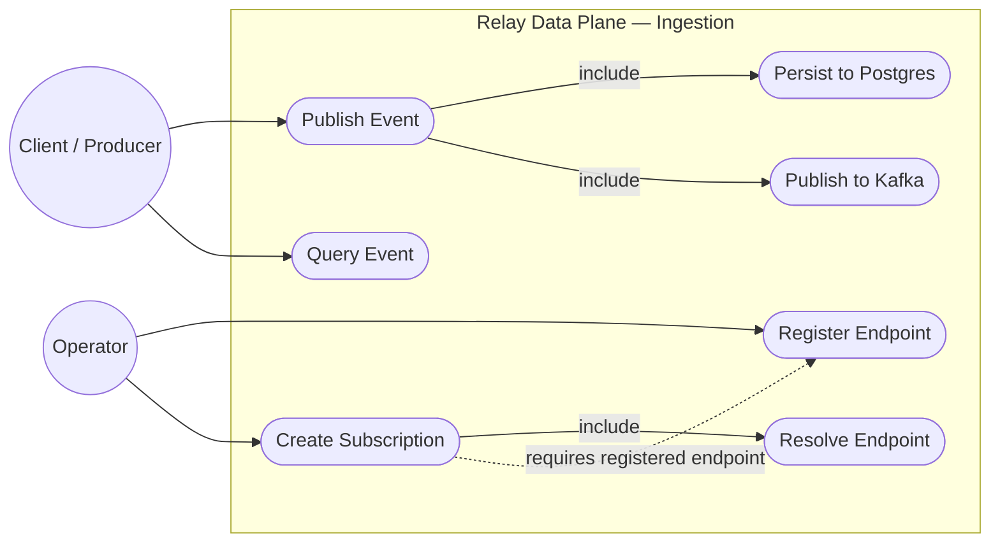

# Data Plane — Use Case Diagram (Weeks 1–2)

Actors and use cases for the ingestion pipeline built in Weeks 1 and 2.
Delivery, retry, and AEDE are out of scope — this diagram is the Data Plane
surface only (`relay/api/`, persistence, Kafka producer wrapper).

Mermaid has no UML use-case shape, so actors are circles and use cases sit
inside the system boundary as stadium nodes (`([ ... ])`).




## Actors

**Client / Producer** — an application (or the Week 1/2 smoke scripts acting as one) that publishes business events and later looks them up by id.

**Operator** — a person or setup script that registers webhook destinations and binds event types to those destinations before traffic flows.

## Use cases


| Use case                | How it is invoked                                     | What the system does                                                                                                                                     |
| ----------------------- | ----------------------------------------------------- | -------------------------------------------------------------------------------------------------------------------------------------------------------- |
| **Publish Event**       | `POST /events` (`event_type` + `payload`)             | Build a frozen `Event` with `CorrelationID` / `CausationID`, **persist first**, then publish to `events.business`. Returns **202** only if both succeed. |
| **Query Event**         | `GET /events/{id}`                                    | Load the event from Postgres. **200** or **404**.                                                                                                        |
| **Register Endpoint**   | `POST /endpoints` (`target_url` + `owner_id`)         | Upsert an `Endpoint` (`is_active=True`). **201**.                                                                                                        |
| **Create Subscription** | `POST /subscriptions` (`endpoint_id` + `event_types`) | Confirm the endpoint exists (**404** if not), then upsert a `Subscription` (`status=ACTIVE`). **201**.                                                   |


**Include** links: Publish Event always runs Persist then Kafka (ADR 0002 persist-first; ADR 0005 — no retry in the HTTP route). Create Subscription always resolves `endpoint_id` before insert (FK to `endpoints`).

**Requires** (dashed): a subscription is only useful after an endpoint is registered. The API enforces that with the lookup + FK, not with Kafka.

Week 1 `scripts/publish_smoke.py` is the same **Publish Event** use case without HTTP — it calls `EventRepository` and `publish()` directly. Week 2 `scripts/api_smoke.sh` is **Publish Event** + **Query Event** over HTTP.

```mermaid
graph TD
    Client([Client / Producer])

    subgraph "FastAPI App (relay/api)"
        RouteEvents[Events Router]
        RouteEndpoints[Endpoints Router]
        RouteSubs[Subscriptions Router]
    end

    subgraph "PostgreSQL (relay/infrastructure/persistence)"
        DBEvents[(events_table)]
        DBEndpoints[(endpoints_table)]
        DBSubs[(subscriptions_table)]
    end

    subgraph "Kafka (relay/infrastructure/messaging)"
        KafkaTopic[[events.business Topic]]
    end

    %% Event Ingestion & Query
    Client -->|1. POST /events| RouteEvents
    Client -->|4. GET /events/{id}| RouteEvents
    
    RouteEvents -->|2. EventRepository.save| DBEvents
    RouteEvents -->|3. KafkaProducer.publish| KafkaTopic
    RouteEvents -.->|5. EventRepository.get_by_id| DBEvents

    %% Endpoints Setup
    Client -->|6. POST /endpoints| RouteEndpoints
    RouteEndpoints -->|7. EndpointRepository.save| DBEndpoints

    %% Subscriptions Setup
    Client -->|8. POST /subscriptions| RouteSubs
    RouteSubs -.->|9. Verify Endpoint Exists| DBEndpoints
    RouteSubs -->|10. SubscriptionRepository.save| DBSubs

    classDef db fill:#f9f0ff,stroke:#333,stroke-width:2px;
    classDef api fill:#e1f5fe,stroke:#333,stroke-width:2px;
    classDef client fill:#fff3e0,stroke:#333,stroke-width:2px;
    
    class DBEvents,DBEndpoints,DBSubs db;
    class RouteEvents,RouteEndpoints,RouteSubs api;
    class Client client;
    ```
```


