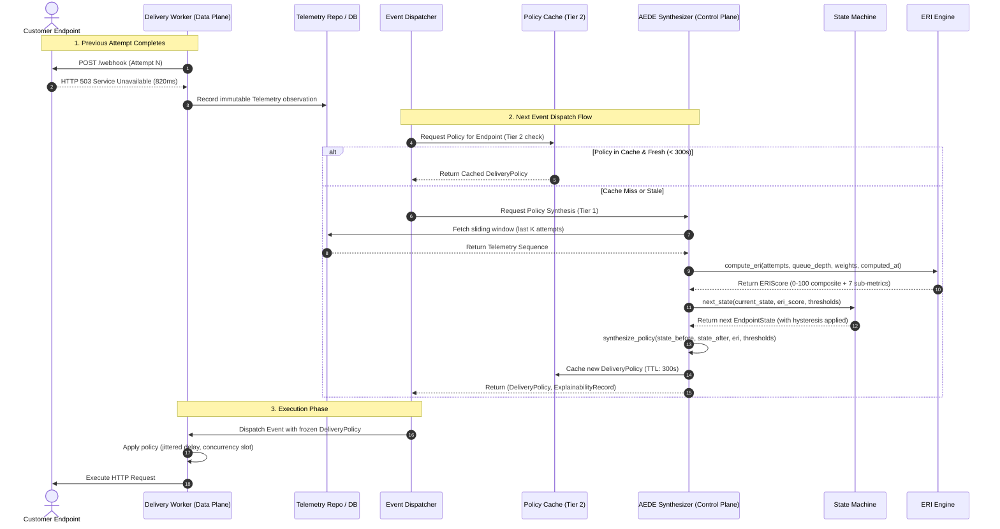
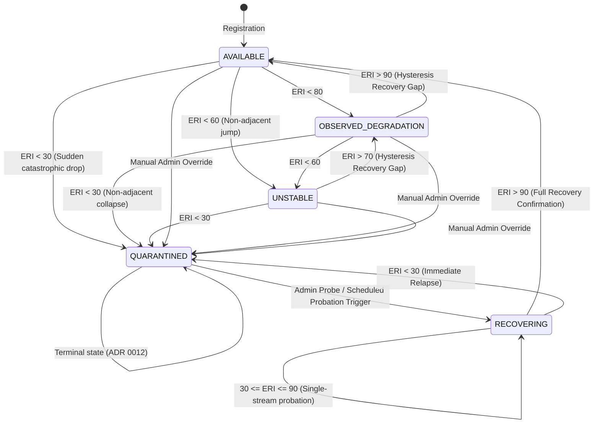
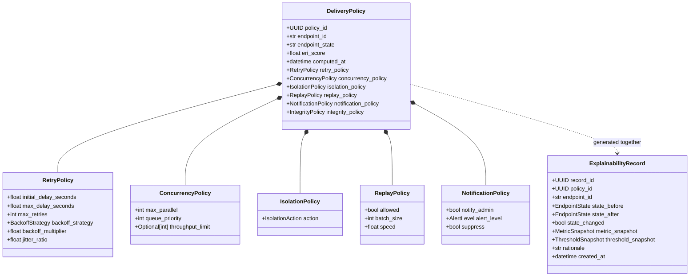
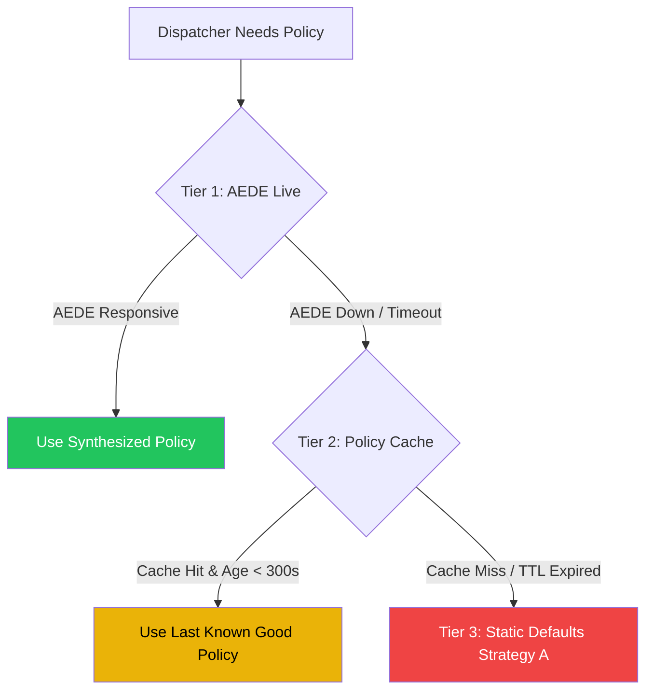

# AEDE Core: Architectural Guide, UML Specifications & Presentation Script

**Author:** Sam (Person B — Research Core & Control Plane Architect)  
**Target Audience:** Academic / Technical Evaluation Panel  
**Document Purpose:** Complete technical walkthrough, UML specifications, state transition mechanics, and word-for-word presentation script for the Adaptive Event Delivery Engine (AEDE).

---

## Table of Contents
1. [Executive Summary & Core Architectural Axiom](#1-executive-summary--core-architectural-axiom)
2. [End-to-End Control Plane Sequence Diagram](#2-end-to-end-control-plane-sequence-diagram)
3. [The Health Oracle: ERI Engine & Mathematical Formulation](#3-the-health-oracle-eri-engine--mathematical-formulation)
4. [Endpoint State Machine & Hysteresis UML](#4-endpoint-state-machine--hysteresis-uml)
5. [Policy Synthesis & Domain Model Class Diagram](#5-policy-synthesis--domain-model-class-diagram)
6. [Step-by-Step Execution Lifecycle: "From Observation to Delivery"](#6-step-by-step-execution-lifecycle-from-observation-to-delivery)
7. [Three-Tier Fallback Hierarchy & Resilience](#7-three-tier-fallback-hierarchy--resilience)
8. [Comprehensive Word-for-Word Presentation Script](#8-comprehensive-word-for-word-presentation-script)
9. [Panel Defense & Q&A Master Cheat Sheet](#9-panel-defense--qa-master-cheat-sheet)

---

## 1. Executive Summary & Core Architectural Axiom

Traditional webhook architectures treat event delivery as a basic HTTP retry problem with static exponential backoff. In the face of downstream degradation, this causes **thundering herd storms, socket exhaustion, cascading failure, and accidental denial-of-service against struggling customer servers**.

Relay reframes event delivery as a **distributed feedback-control problem**.

### The Non-Negotiable Architectural Law
```
┌─────────────────────────────────────────────────────────────────────────┐
│                      THE CORE ARCHITECTURAL LAW                         │
│                                                                         │
│   The Control Plane DECIDES.               The Data Plane EXECUTES.     │
│   (AEDE, State Machine, ERI)               (Dispatcher, Workers)        │
│                                                                         │
│   • Evaluates health                       • Receives frozen policy     │
│   • Derives state                          • Signs payload              │
│   • Synthesizes multi-metric policy        • Sends HTTP request         │
│   • Never makes HTTP delivery requests     • Never computes delays/ERI  │
└─────────────────────────────────────────────────────────────────────────┘
```

If a worker calculates retry intervals, it violates the boundary.  
If AEDE initiates network delivery, it violates the boundary.

---

## 2. End-to-End Control Plane Sequence Diagram

This sequence diagram illustrates how telemetry flows from a completed delivery attempt through AEDE, and how the resulting policy informs the next delivery attempt.



---

## 3. The Health Oracle: ERI Engine & Mathematical Formulation

**File Reference:** [`relay/control_plane/eri/calculator.py`](file:///c:/Users/sammj/MajorProject/relay/control_plane/eri/calculator.py)

The **Endpoint Reliability Index (ERI)** is a continuous deterministic score in the range $[0.0, 100.0]$. It evaluates a sliding window of the last $K$ attempts across seven weighted signals:

$$\text{ERI} = \left( \sum_{i=1}^{7} S_i \times W_i \right) \times 100.0$$

### Sub-Metric Formulation & Operational Intuition

| # | Sub-Metric ($S_i$) | Default Weight ($W_i$) | Formulation | Operational Rationale |
|---|---|---|---|---|
| 1 | **Success Rate** | $0.35$ | $\frac{\text{successes}}{\text{total\_attempts}}$ | Baseline indicator of delivery viability. |
| 2 | **Latency Degradation** | $0.20$ | $\begin{cases} 1.0 & \text{avg} \le B \\ 0.0 & \text{avg} \ge M \\ 1.0 - \frac{\text{avg} - B}{M - B} & \text{otherwise} \end{cases}$ | "Slow is the new down." Linear interpolation between baseline SLA ($B=200\text{ms}$) and ceiling ($M=1000\text{ms}$). |
| 3 | **Consecutive Failures** | $0.20$ | $\max\left(0.0, 1.0 - \frac{\text{streak}}{\text{max\_streak}}\right)$ | Scanned backward from tail. Detects sudden acute outages even if overall window success rate looks acceptable. |
| 4 | **Timeout Penalty** | $0.10$ | $\frac{\text{total} - \text{timeouts}}{\text{total}}$ | Timeouts block worker sockets and connection pools for 10–30s, causing severe backpressure compared to fast rejections. |
| 5 | **HTTP 5xx Errors** | $0.05$ | $\frac{\text{total} - \text{5xx\_count}}{\text{total}}$ | Differentiates application-level crashes from network drops or rate limits. |
| 6 | **Queue Depth** | $0.05$ | $\max\left(0.0, 1.0 - \frac{Q}{Q_{\max}}\right)$ | Quantifies broker backlog pressure. |
| 7 | **Recovery Trend** | $0.05$ | Split-half comparison: $\text{SR}_2\text{ vs }\text{SR}_1$ | Evaluates trend by comparing the older half of the window with the newer half. Detects whether an endpoint is healing or decaying. |

### Mathematical Determinism Guarantee
Notice line 16 of `calculator.py`: `computed_at: datetime` is an explicit argument. **Zero calls to `datetime.now()` exist inside domain code.** Identical telemetry input sequences always produce the exact same ERI score down to the microsecond.

---

## 4. Endpoint State Machine & Hysteresis UML

**File Reference:** [`relay/control_plane/state_machine/transitions.py`](file:///c:/Users/sammj/MajorProject/relay/control_plane/state_machine/transitions.py)

Relay models endpoints using a 5-State Finite State Machine with asymmetric hysteresis boundaries.

### State Transition Diagram



### Hysteresis Threshold Table

```
ERI Score Scale:
  0                   30               60        70        80        90          100
  ├─── QUARANTINED ───┼─── UNSTABLE ───┼─────────┼── DEGR ─┼─────────┼── AVAIL ──┤
                      ▲                ▲         ▲         ▲         ▲
                      │                │         │         │         └─ Recovery to AVAILABLE (>90)
                      │                │         │         └─ Drop to DEGRADATION (<80)
                      │                │         └─ Recovery to DEGRADATION (>70)
                      │                └─ Drop to UNSTABLE (<60)
                      └─ Drop to QUARANTINED (<30)
```

- **Degradation Hysteresis:** An endpoint drops to `OBSERVED_DEGRADATION` at **ERI < 80**, but requires **ERI > 90** to return to `AVAILABLE`. This 10-point deadband prevents rapid state flapping when an endpoint fluctuates around 80.
- **Unstable Hysteresis:** An endpoint enters `UNSTABLE` at **ERI < 60**, but requires **ERI > 70** to recover to `OBSERVED_DEGRADATION`.
- **Quarantine Terminality (ADR 0012):** Once in `QUARANTINED`, passive traffic is zeroed out. The state machine will never auto-transition out of quarantine through standard traffic, because no traffic is allowed to run. It requires active single-packet probation into `RECOVERING`.

---

## 5. Policy Synthesis & Domain Model Class Diagram

**File Reference:** [`relay/control_plane/aede/synthesizer.py`](file:///c:/Users/sammj/MajorProject/relay/control_plane/aede/synthesizer.py) and [`relay/kernel/policies/delivery_policy.py`](file:///c:/Users/sammj/MajorProject/relay/kernel/policies/delivery_policy.py)

The synthesizer translates `(EndpointState, ERIScore, StateMachineThresholds)` into a frozen, immutable `DeliveryPolicy` and an `ExplainabilityRecord`.



### State-to-Policy Mapping Matrix

| State | Max Parallel | Initial Delay | Max Retries | Jitter Ratio | Isolation Action | Replay Allowed | Admin Alert |
|---|---|---|---|---|---|---|---|
| **`AVAILABLE`** | 10 | 2.0s | 10 | **0.00** | `CONTINUE` | False | None (INFO) |
| **`OBSERVED_DEGRADATION`** | 3 | 5.0s | 8 | **0.10** | `REDUCE_CONCURRENCY` | False | WARNING |
| **`UNSTABLE`** | 1 | 15.0s | 5 | **0.15** | `PAUSE` | False | WARNING (Notify Admin) |
| **`QUARANTINED`** | 1 | 300.0s | 0 | **0.00** | `QUARANTINE` | False | CRITICAL (Alert Admin) |
| **`RECOVERING`** | 1 | 10.0s | 6 | **0.25** | `CONTINUE` | True (Batch=10, Speed=0.5) | INFO |

---

## 6. Step-by-Step Execution Lifecycle: "From Observation to Delivery"

Here is how an endpoint progresses through the AEDE lifecycle during a real degradation and recovery event:

```
[STAGE 1: Healthy Steady State]
• Endpoint responding in 45ms, 100% 200 OK.
• ERI Score = 100.0.
• State = AVAILABLE.
• Policy: Concurrency = 10 parallel, immediate retries, jitter = 0.0.

                │
                ▼ Downstream DB locks up; response time climbs to 850ms
[STAGE 2: Latency Degradation (Canary Phase)]
• Success rate is STILL 100% (no 5xx yet!).
• ERI Latency Score collapses from 1.0 to 0.187.
• Composite ERI drops to 78.5 (crossing degradation threshold of 80).
• State Machine Transition: AVAILABLE ➔ OBSERVED_DEGRADATION.
• Policy Synthesizer Action:
  - Concurrency throttled from 10 down to 3.
  - Delay widened to 5.0s.
  - Jitter set to 0.10.
  - Explainability Record stored: "Latencies degraded beyond 200ms baseline."

                │
                ▼ Endpoint throws 503s under load; consecutive failures = 4
[STAGE 3: Severe Instability]
• ERI drops to 52.0 (crossing unstable threshold of 60).
• State Machine Transition: OBSERVED_DEGRADATION ➔ UNSTABLE.
• Policy Synthesizer Action:
  - Concurrency dropped to 1 (single-stream serialization).
  - New deliveries paused; retries spaced to 15.0s.
  - Admin alert emitted.

                │
                ▼ Total crash; connection refused
[STAGE 4: Quarantine Cutoff]
• ERI drops to 18.0 (crossing quarantine threshold of 30).
• State Machine Transition: UNSTABLE ➔ QUARANTINED.
• Policy Synthesizer Action:
  - max_retries = 0.
  - Delivery halted immediately. Traffic routed to Dead Letter Queue (DLQ).
  - Downstream customer server is protected from incoming requests.

                │
                ▼ Customer deploys fix; Admin schedules recovery probation
[STAGE 5: Probationary Recovery & Thundering Herd Prevention]
• State transitioned to RECOVERING.
• Policy Synthesizer Action:
  - Concurrency restricted to 1 (probe mode).
  - Replay allowed in small batches (10 events at 0.5 speed).
  - Jitter ratio set to 0.25!
    *Why?* De-correlates queued replay events, preventing a replay burst
    from crashing the newly recovered server.

                │
                ▼ 10 probe deliveries succeed in 50ms; ERI reaches 94.2
[STAGE 6: Full Restoration via Hysteresis]
• ERI crosses recovery threshold (90).
• State Machine Transition: RECOVERING ➔ AVAILABLE.
• Concurrency fully restored to 10. Normal delivery resumed.
```

---

## 7. Three-Tier Fallback Hierarchy & Resilience

**File Reference:** [`relay/infrastructure/cache.py`](file:///c:/Users/sammj/MajorProject/relay/infrastructure/cache.py)



### Fallback Guarantee
1. **Tier 1 (AEDE Live):** Dynamic, multi-metric policy synthesized on every telemetry change.
2. **Tier 2 (Cache):** Stored in Redis/Memory with a 300-second TTL. If AEDE is restarted or suffers an intermittent network split, the Dispatcher serves the last known state.
3. **Tier 3 (Static Strategy A):** Hard-coded safe defaults (`initial_delay=5s`, `max_delay=300s`, `max_parallel=1`). Even during total control plane failure, delivery degrades gracefully rather than crashing.

---

## 8. Comprehensive Word-for-Word Presentation Script

*Use this script for your presentation. Words in bold are emphasis markers; bracketed notes are actions to perform.*

---

### [0:00 - 1:30] Introduction & The Core Architectural Law

> **[ACTION: Stand confidently, display Relay Overview Slide / Architecture Diagram]**

"Good morning, members of the panel.

Today, webhook delivery is the backbone of SaaS, fintech, and cloud integrations. Yet, the industry overwhelmingly handles outbound event delivery as a simple HTTP retry problem with static exponential backoff.

When an external customer endpoint degrades, existing systems retry blindly. The inevitable outcome is **thundering herds, connection pool exhaustion, and launching an accidental denial-of-service attack against the customer’s struggling server**.

In Relay, we formulated event delivery not as an HTTP problem, but as a **distributed feedback-control problem**. 

I designed and implemented the research core and control plane of this platform: the **Adaptive Event Delivery Engine**, or **AEDE**.

Our platform operates under one non-negotiable architectural law:

> **The Control Plane decides. The Data Plane executes.**

Our delivery workers are stateless execution units. They never calculate a retry interval, they never evaluate endpoint health, and they never make runtime decisions. AEDE acts as the centralized, deterministic brain that evaluates incoming telemetry and synthesizes immutable delivery policies.

Let me take you directly into the code to show how this engine works."

---

### [1:30 - 3:30] The Health Oracle: ERI Engine & Mathematics

> **[ACTION: Open [`relay/control_plane/eri/calculator.py`](file:///c:/Users/sammj/MajorProject/relay/control_plane/eri/calculator.py#L8-L100) — Highlight `compute_eri`]**

"Every control system requires an objective, continuous signal of health. For Relay, I developed the **Endpoint Reliability Index**, or **ERI**, located here in `calculator.py`.

ERI outputs a deterministic score from **0 to 100**. Rather than relying on naive binary health checks, `compute_eri` calculates a weighted composite across **seven multi-dimensional sub-metrics** over an attempt-count sliding window:

1. **Success Rate (35% weight):** The baseline ratio of 200 OKs.
2. **Latency Degradation (20% weight):** Highlighted on Line 35. This is our canary in the coal mine. We linearly interpolate between a healthy baseline of 200ms and an SLA ceiling of 1000ms. An endpoint that responds with 200 OK but takes 800ms is showing acute pre-failure strain.
3. **Consecutive Failures (20% weight):** Scanned backward from the tail. A streak of 4 quick failures will drastically reduce the score, even if historical success rate looks acceptable.
4. **Timeout Penalties (10% weight):** Timeouts are penalized heavier than fast HTTP 500 rejections because a hanging connection holds worker sockets and thread pools open for up to 30 seconds.
5. **HTTP 5xx Errors (5% weight):** Explicit downstream server internal crashes.
6. **Queue Depth (5% weight):** Captures message backlog backpressure.
7. **Recovery Trend (5% weight):** We split the sliding window in half and compare the first half to the second half. If the second half has a higher success rate, the engine rewards the endpoint with a positive recovery trend, detecting that healing has begun.

**Look at line 16:**
Notice `computed_at: datetime` is passed as an explicit parameter. **`datetime.now()` is never called inside domain calculations.** This guarantees absolute mathematical determinism. The exact same telemetry sequence will always produce the identical ERI score down to the microsecond, ensuring 100% test reproducibility."

---

### [3:30 - 5:00] The 5-State Finite State Machine & Hysteresis

> **[ACTION: Open [`relay/control_plane/state_machine/transitions.py`](file:///c:/Users/sammj/MajorProject/relay/control_plane/state_machine/transitions.py#L6-L53)]**

"Once ERI is computed, what drives delivery behavior?

In `transitions.py`, I implemented a **5-State Finite State Machine**:
- `AVAILABLE` (Normal operation)
- `OBSERVED_DEGRADATION` (Pre-failure strain)
- `UNSTABLE` (Severe packet failure)
- `QUARANTINED` (Halt all traffic)
- `RECOVERING` (Single-stream probation)

I want to draw the panel’s attention to two crucial engineering mechanisms in this code:

#### 1. Dual-Threshold Hysteresis
If an endpoint oscillates right at a threshold—say between 79 and 81—a naive state machine flaps rapidly between states.
In our state machine:
- To enter `OBSERVED_DEGRADATION`, ERI must drop below **80**.
- But to recover back to `AVAILABLE`, ERI must cross **90** (`degradation_recovery_threshold`).
This 10-point hysteresis deadband completely eliminates state oscillation and prevents thrashing worker pools.

#### 2. Non-Adjacent Jumps & Terminal Quarantine
Lines 19 and 29 show non-adjacent transitions: if an endpoint suffers sudden catastrophic failure, it does not step down gradually; it jumps immediately from `AVAILABLE` to `QUARANTINED`.
Furthermore, per **ADR 0012**, once quarantined, passive traffic is zeroed out. The endpoint cannot accidentally leak traffic until explicit recovery probation is engaged."

---

### [5:00 - 7:00] Policy Synthesis & Explainability

> **[ACTION: Open [`relay/control_plane/aede/synthesizer.py`](file:///c:/Users/sammj/MajorProject/relay/control_plane/aede/synthesizer.py#L40-L160)]**

"Now we connect the health state to real execution in the **Policy Synthesizer**.

`synthesize_policy` is a pure function. It maps the state and ERI into an immutable `DeliveryPolicy` containing six sub-policies:
- `RetryPolicy` (delays, max retries, backoff strategy, jitter)
- `ConcurrencyPolicy` (parallel delivery limits, queue priority)
- `IsolationPolicy` (continue, reduce concurrency, pause, quarantine)
- `ReplayPolicy` (allowed, batch size, speed)
- `NotificationPolicy` (alert thresholds)
- `IntegrityPolicy` (HMAC signatures)

**Observe how dynamically the platform throttles:**
- In `AVAILABLE`: We allow 10 parallel connections, immediate retries, and full speed.
- In `OBSERVED_DEGRADATION`: Concurrency drops from 10 to 3, and retry delays widen to 5 seconds.
- In `UNSTABLE`: Delivery is serialized to a single stream (`max_parallel = 1`), and new traffic is paused.
- In `QUARANTINED`: `max_retries = 0`. Traffic is halted immediately to protect the downstream receiver.
- In `RECOVERING`: Concurrency is locked at 1, and replay batches of 10 events are processed at half speed (`0.5`) to safely probe the endpoint.

#### Enterprise Explainability (Line 162)
Every single policy synthesized creates an immutable `ExplainabilityRecord`. In enterprise infrastructure, black-box algorithms are unacceptable. Our system logs:
- Exact sub-metric scores,
- The threshold values evaluated against,
- The state transition that took place, and
- Human-readable rationale text.
We persist this to PostgreSQL, feeding live explainability directly to the dashboard."

---

### [7:00 - 8:30] Resilience, Hardening & The Three-Tier Fallback

> **[ACTION: Open [`relay/infrastructure/cache.py`](file:///c:/Users/sammj/MajorProject/relay/infrastructure/cache.py#L1-L32)]**

"A research idea is only as good as its production resilience. What happens if AEDE crashes or Redis is partitioned? Does the platform halt?

We established the **Three-Tier Policy Fallback Hierarchy (ADR 0011)**:
- **Tier 1 (Normal):** AEDE live policy synthesis.
- **Tier 2 (Degraded):** If AEDE is unreachable, the Dispatcher queries the `PolicyCache` for the last-known-good policy (with a 300-second TTL).
- **Tier 3 (Fail-Safe):** If the cache is cold or expired, the system falls back to Strategy A static defaults.
The workers *still* do not compute policy logic—they simply receive the Tier 3 static contract.

#### Recent Audit Hardening
During our sprint audit, I resolved three critical engineering concerns:
1. **Thundering Herd Resolution:** When an endpoint recovers and queued events replay, simultaneous retries can immediately crash it again. I added `jitter_ratio` directly to `RetryPolicy` in the Kernel, and configured state-aware jitter in AEDE (specifically **25% jitter on `RECOVERING`**, while keeping **0.0% on `AVAILABLE`** for determinism). This de-correlates retries while strictly preserving the boundary: AEDE dictates the jitter; workers merely apply it.
2. **Cache Safety:** In `relay/infrastructure/cache.py`, I hardened the cache with timezone-aware UTC handling, active wall-clock TTL evaluation, and a bounded FIFO eviction limit (1024 entries) to eliminate memory leaks.
3. **SSRF Outbound Guard:** Unwrapped IPv6 6to4 and IPv4-mapped encapsulated addresses in `url_guard.py` so internal loopback targets cannot bypass egress firewalls."

---

### [8:30 - 9:30] Research Evaluation & Conclusion

> **[ACTION: Open [`relay/control_plane/aede/strategies/`](file:///c:/Users/sammj/MajorProject/relay/control_plane/aede/strategies/) or Terminal showing tests passed]**

"To validate our research contribution empirically, I implemented three comparative baseline strategies under `relay/control_plane/aede/strategies/`:
- **Strategy A (Industry Baseline):** Static exponential backoff (e.g., standard Stripe/GitHub model).
- **Strategy B (Adaptive Baseline):** Dynamic backoff scaling solely with recent success rate, but without an endpoint state machine.
- **Strategy C (Our Contribution — AEDE):** Full 5-state machine, 7-signal ERI, and multi-dimensional policy synthesis.

Our automated benchmark framework subjects all three strategies to 10 identical simulated fault scenarios.

**To conclude:**
- The entire codebase is verified with **250 passing automated tests** with zero regressions.
- The control plane boundary is clean: AEDE decides, the Data Plane executes.
- Every automated decision is 100% explainable and deterministic.

Thank you. I welcome the panel’s questions."

---

## 9. Panel Defense & Q&A Master Cheat Sheet

### Q1: "Why build a custom ERI and State Machine instead of using an off-the-shelf circuit breaker like Netflix Hystrix or Resilience4j?"
> **Answer:**  
> "Circuit breakers like Hystrix or Resilience4j are designed for synchronous, low-latency microservice RPCs where the goal is to 'fail-fast' to protect the caller.  
> Webhook delivery is fundamentally different: it is an **asynchronous, guaranteed-delivery outbound pipeline** over untrusted public networks. Standard circuit breakers have only 3 coarse states (Closed, Open, Half-Open) driven by binary failure counts. They cannot express multi-dimensional control—such as dropping concurrency from 10 to 3 while keeping deliveries flowing (`OBSERVED_DEGRADATION`), nor can they evaluate creeping latency degradation or recovery trend splitting. AEDE is purpose-built for outbound delivery control."

---

### Q2: "Why can't workers just apply random jitter locally like AWS recommends?"
> **Answer:**  
> "Because that violates our Core Architectural Law: *The Control Plane decides; the Data Plane executes.*  
> If workers decide jitter locally, the Data Plane begins making runtime policy decisions. More importantly, jitter requirements are state-dependent. During normal operation (`AVAILABLE`), we want zero jitter for predictable, deterministic execution. During recovery (`RECOVERING`), when dozens of queued replay events hit an endpoint at once, we need aggressive de-correlation (25% jitter). By putting `jitter_ratio` into `RetryPolicy`, the Control Plane dictates *how much* randomness is safe, and the worker simply carries out the math."

---

### Q3: "How do you justify your ERI weights? Aren't they arbitrary?"
> **Answer:**  
> "The weights reflect the operational cost of distinct failure modes in an outbound delivery pipeline. For example, timeouts tie up HTTP connection pool slots for 10–30 seconds, which is far more damaging to worker throughput than an immediate HTTP 500 error, so timeouts carry a distinct penalty.  
> Furthermore, the weights are not hardcoded. They are passed as an `ERIWeights` configuration object loaded from `config.yaml`. This decoupling allows operators to tune weights for different endpoint SLA tiers without changing a single line of domain code."

---

### Q4: "What happens if an endpoint is flapping right at the degradation threshold?"
> **Answer:**  
> "Dual-threshold hysteresis solves this. In `transitions.py`, an endpoint drops to `OBSERVED_DEGRADATION` when ERI falls below **80**. However, it cannot return to `AVAILABLE` until ERI rises above **90**. An endpoint fluctuating between 78 and 82 remains in degradation; it does not flap. It must prove sustained recovery above 90 before full concurrency is restored."

---

### Q5: "How does the system ensure mathematical determinism?"
> **Answer:**  
> "We strictly isolate telemetry collection from policy evaluation. In `compute_eri`, `next_state`, and `synthesize_policy`, all inputs—the attempt telemetry array, the queue depth, the thresholds, and crucially the `computed_at` timestamp—are passed as explicit arguments. There is no call to `datetime.now()` or `random()` inside the synthesizer. Feeding the exact same attempt history into the function 10,000 times will output the exact same `DeliveryPolicy` down to the microsecond every single time. That is essential for reproducible research benchmarks and auditability."

---

### Q6: "What happens if AEDE crashes completely?"
> **Answer:**  
> "The Three-Tier Fallback Hierarchy engages immediately. The Dispatcher first checks the Policy Cache for the last-known-good policy (TTL 300s). If the cache is cold or expired, the system serves Tier 3 static defaults (Strategy A: exponential backoff, concurrency=1, admin alerted). The workers continue executing deliveries using the safe static contract. Delivery degrades gracefully rather than halting, and when AEDE recovers, the system automatically returns to Tier 1."
